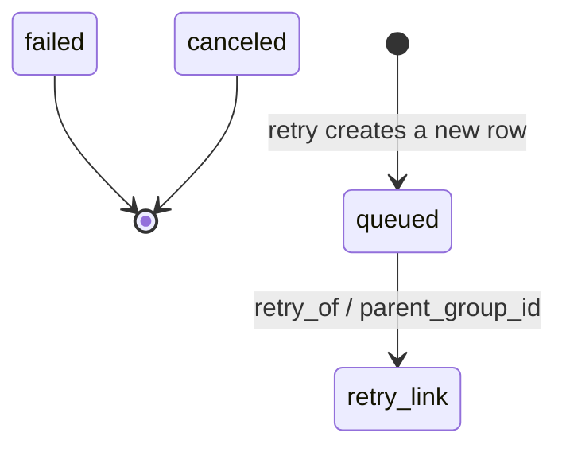

# Canonical Job Lifecycle

Status: architecture proposal derived from the validated audit in
[`STATE_MACHINES.md`](./STATE_MACHINES.md). This document is descriptive, not
implemented. No code, schema, or migration was changed.

Legend: **[V]** verified current behavior, **[R]** recommendation, **[A]**
assumption.

## 1. Why a new lifecycle model

The current job row carries one `status` string that is asked to answer four
different questions:

1. **Is a worker executing this?** (`queued`, `running`, `paused`)
2. **Did execution finish, and how?** (`completed`, `failed`, `canceled`)
3. **Is the data complete?** (currently `error_message` + checkpoint)
4. **Are the artifacts available and delivered?** (paths + `s3_*`)

Those questions have different transitions, different owners, and different
failure modes. Collapsing them into one string is why `completed` can mean
"clean", "missing ID batches", "rollup with missing days", "preview", and
"files expired" at the same time.

The canonical model keeps the six public statuses for compatibility, then adds
**two orthogonal dimensions**:

```
execution_status : queued | running | paused | completed | failed | canceled
completion_state : unknown | complete | partial
delivery_state   : (derived, not persisted) none | local | s3_pending | s3_partial | s3_uploaded | s3_failed | expired
```

Only `execution_status` and `completion_state` need persistence. `delivery_state`
and all UI/group/report statuses are derived through shared helpers. This follows
the rule that a derived state does not get a column just because it has a name.

## 2. The three concerns

### 2.1 Execution status

Answers: *what is the worker doing?*

| State | Meaning | Entered by | Persisted? |
|---|---|---|---|
| `queued` | accepted, not claimed | create, retry, resume, schedule, group, rollup | yes |
| `running` | a worker owns the lease | worker claim | yes |
| `paused` | worker stopped at a safe boundary, checkpoint retained | pause acknowledged | yes |
| `completed` | execution loop ended without a fatal error | worker finalizer | yes |
| `failed` | execution ended with an error, or the lease was reaped | worker / reaper | yes |
| `canceled` | a cancel request was honored, or a queued job was canceled | API / worker | yes |

Rules:

- Terminal states never transition on the same row.
- `paused` is not terminal; it can be resumed or canceled.
- A retry never mutates a terminal row. It creates a new row and links lineage.
- `completed` says nothing about completeness or delivery. Those are separate.

### 2.2 Data completeness

Answers: *does the artifact cover the requested window and ID set?*

| State | Meaning | Examples |
|---|---|---|
| `unknown` | legacy row, or the worker crashed before recording coverage | pre-migration rows; reaped mid-run |
| `complete` | the loop reached `end_epoch`, no ID batches were skipped, all rollup sources were usable | normal full run |
| `partial` | a known gap exists | skipped ID batches; rollup skipped source runs; intentional preview cap; uncovered range if one is ever reachable |

Recommended persisted fields:

- `completion_state` (`unknown|complete|partial`) - default `unknown` for
  existing rows; new terminal writes set it explicitly.
- `gap_count` (integer) - number of skipped ID batches or skipped rollup
  sources.
- `gap_reason` (text) - human-readable, structured enough to display without
  parsing `error_message`.

Why not a `completed_with_gaps` status **[R]**:

- It would multiply the status vocabulary in 14 places and break every
  `status == "completed"` consumer.
- Completeness is orthogonal: a failed or canceled job can also be partial, and
  a preview is partial by design.
- A separate field lets reports/groups/UI opt in without changing the public
  state machine.

Preview handling:

- `is_preview=true` is already persisted and is the discriminator. Do **not**
  set `completion_state=partial` for every preview by default; a preview is
  intentionally capped, and marking it partial would pollute dashboards. Use
  `is_preview` first, then `completion_state` for full runs. If a unified
  helper is preferred, return `preview` as a derived completeness value
  without persisting it.

### 2.3 Artifact and delivery

Answers: *can the operator get the bytes, and where are they?*

Do **not** add a persisted `artifact_state` solely for display. Derive it:

| Derived state | Rule |
|---|---|
| `none` | no artifact paths set |
| `local` | at least one path set and the file exists; no S3 destination |
| `s3_pending` | S3 destination configured, job completed, no URI and no error |
| `s3_partial` | some `s3_*_uri` set and `s3_error` set |
| `s3_uploaded` | all expected artifacts have URIs and no error |
| `s3_failed` | destination configured, no URI, error set |
| `expired` | paths were nulled by retention; job remains terminal |

Caveats:

- `has_output` currently uses `os.path.exists` on single-job reads and
  path-presence on list reads **[V]** (`jobs.py:76-99`, `705-748`). A list can
  say "has output" for a file that was deleted between the query and the click.
  This is acceptable for a list, but the detail view must remain authoritative.
- Retention deletes files while the job stays `completed` **[V]**
  (`scheduler.py:288-320`). That is a file lifecycle, not a job status. The
  derived state must show `expired`, not a new job status.
- S3 partial success needs an explicit aggregate rule. The current UI badge is
  "error if any error, else uploaded if raw URI, else pending" **[V]**
  (`jobs/[id]/page.tsx:552-554`), which hides successful artifacts.

## 3. Canonical state diagram

```mermaid
stateDiagram-v2
    [*] --> queued: create / retry / schedule / group / rollup
    queued --> running: claim (lease acquired)
    queued --> paused: pause request honored before claim
    queued --> canceled: cancel (no worker)
    running --> paused: worker observes pause at a safe boundary
    running --> completed: loop ends; completion_state set
    running --> failed: exception
    running --> failed: reaper (lease expired)
    running --> canceled: worker observes cancel; partial artifact kept
    paused --> queued: resume + dispatch
    paused --> canceled: cancel
    completed --> [*]
    failed --> [*]
    canceled --> [*]
```



Terminal states have no outgoing edges on the same row. Retry is a new row:



## 4. Canonical transition table

The authoritative table is in
[`STATE_TRANSITIONS.md`](./STATE_TRANSITIONS.md). The lifecycle rules are
summarized here.

| # | From | To | Trigger | Guard | Side effects |
|---|---|---|---|---|---|
| J1 | - | `queued` | create/import/retry/schedule/group/rollup | validation passes | insert row, audit, dispatch |
| J2 | `queued` | `running` | worker claim | `status='queued'` **or** (`status='running'` and lease expired and redelivered) | set owner, bump lease token, `started_at`, clear `error_message`, event |
| J3 | `running` | `running` | heartbeat/reclaim | owner token matches, or lease expired + redelivery | `heartbeat_at`, event |
| J4 | `queued`/`running` | `paused` | pause | not terminal | set `pause_requested_at`; worker acknowledges |
| J5 | `paused` | `queued` | resume | `status='paused'` | clear pause request, dispatch |
| J6 | `queued` | `canceled` | cancel | not terminal | set `cancel_requested_at`, `finished_at`, `completion_state` |
| J7 | `running` | `canceled` | cancel acknowledged | owner token matches, `cancel_requested_at` set | finalize partial artifact, `finished_at` |
| J8 | `running` | `completed` | worker finalizer | owner token matches **and** no cancel request | set `completion_state`, artifacts, `finished_at` |
| J9 | `running` | `failed` | worker exception | owner token matches | set `completion_state=unknown/partial`, `error_message`, `finished_at` |
| J10 | `running` | `failed` | reaper | heartbeat older than threshold | bump lease token, fail, alert |
| J11 | `paused` | `canceled` | cancel | `status='paused'` | set `finished_at`, keep checkpoint/artifact |

### 4.1 Forbidden transitions

| Attempt | Result |
|---|---|
| pause `completed|failed|canceled` | 409, no write |
| resume anything except `paused` | 409, no write |
| retry anything except `failed|canceled` | 409, no write |
| claim `paused|completed|failed|canceled` | no-op |
| claim `running` without redelivery | no-op |
| terminal -> terminal on the same row | no-op |
| non-owner writes `running|paused|completed|failed` | 0 rows updated; worker aborts |
| cancel after `completed` | 409, no write |

### 4.2 What "cancel" means

Current behavior writes `canceled` immediately, which is why a late worker
write can overwrite it **[V]** (`jobs.py:858-866`, `runner.py:830-831`).
The canonical model distinguishes request and acknowledgement:

- `POST /cancel` sets `cancel_requested_at` and leaves `running` (or sets
  `canceled` immediately for `queued`).
- The worker polls `cancel_requested_at`/`status` every 10 s between rows and
  at chunk boundaries.
- The worker writes `canceled` with a lease-guarded update.
- If the worker reaches the end first, it must **not** write `completed` when
  `cancel_requested_at` is set; it writes `canceled` with the partial artifact.
- The API can still return `canceled` immediately for UX if it sets both
  `status='canceled'` and `cancel_requested_at`; the worker's terminal write
  must then be guarded by `status IN ('running','canceled')` and must never
  move `canceled` back to `completed`.

The simplest compatible rule:

```sql
-- worker finalizer
UPDATE jobs
   SET status = CASE WHEN cancel_requested_at IS NOT NULL THEN 'canceled' ELSE 'completed' END,
       ...
 WHERE id = :id
   AND owner_id = :owner
   AND lease_token = :token
   AND status IN ('running', 'canceled')
```

This preserves the immediate `canceled` response and makes the worker's write
idempotent rather than a competing transition.

### 4.3 Pause is a request, not an acknowledgement

Current pause returns `paused` immediately **[V]** (`jobs.py:834-837`). The
worker may take up to `STATUS_CHECK_SECONDS` (10 s) per row, longer during a
blocking HTTP call **[V]** (`runner.py:57`, `647-652`). The canonical model
records:

- `pause_requested_at` (nullable) - set by the API.
- `status` stays `running` until the worker acknowledges.
- The API may return a `pause_pending` derived flag for the UI.

If the compatibility requirement is "return `paused` immediately", keep the
current status write but add a fence so a resume cannot race the old worker:
resume must increment the lease token and the worker must re-check ownership
after every status read. A worker that sees its token stale must abort.

## 5. Ownership and fencing

### 5.1 Problem

The current claim is conditional, but every later write is unconditional
**[V]** (`db.py:185-186`, `runner.py:626-630`, `830-895`). Reclaim and
pause/resume create two writers with the same `job_id` and no way to tell them
apart **[V]**.

### 5.2 Proposed lease

Persist on `jobs`:

| Field | Type | Purpose |
|---|---|---|
| `owner_id` | varchar(128), nullable | worker instance id / hostname+pid |
| `lease_token` | bigint, not null, default 0 | monotonic fencing token |
| `heartbeat_at` | timestamptz, nullable | last liveness write |
| `cancel_requested_at` | timestamptz, nullable | cancel request marker |
| `pause_requested_at` | timestamptz, nullable | pause request marker |

Claim:

```sql
UPDATE jobs
   SET status = 'running',
       owner_id = :owner,
       lease_token = lease_token + 1,
       heartbeat_at = now(),
       started_at = now(),
       error_message = NULL
 WHERE id = :id
   AND ( status = 'queued'
         OR (status = 'running' AND heartbeat_at < now() - :reclaim_interval) )
RETURNING lease_token;
```

Every worker write:

```sql
UPDATE jobs
   SET ...
 WHERE id = :id
   AND owner_id = :owner
   AND lease_token = :token
   AND status = 'running';   -- or IN ('running','canceled') for the finalizer
```

If `rowcount == 0`, the worker is fenced: close files, stop writing, and exit
without changing the row. This is the only reliable way to make reclaim safe.

Heartbeat:

- Update `heartbeat_at` every 5 minutes while streaming.
- Do not rely on `job_events` for ownership; events are useful for the reaper
  but are not a lease.
- The reaper increments `lease_token` when it fails a job, so a late worker
  cannot revive it.

### 5.3 Rollup must use the same lease

`run_rollup` currently sets `running` unconditionally **[V]**
(`rollup.py:85`). It must call the same claim function, check the token on
every update, and poll for cancel/pause. Otherwise the fencing model has a
hole exactly where duplicate processing is most expensive.

### 5.4 Reclaim policy

- Only a redelivered Celery task may reclaim.
- Reclaim only if `heartbeat_at` is older than `stale_reclaim_minutes` (10 min)
  and the row is `running`.
- On reclaim, emit an event and increment the lease token.
- The old worker's next write fails the token check and aborts.

## 6. Retry semantics

Current retry creates a new row and does not copy `checkpoint` **[V]**
(`jobs.py:975-996`). The reaper message says "Retry to resume from the last
checkpoint" **[V]** (`scheduler.py:211-214`), which is false.

Choose one canonical semantic and make the UI/message match:

### Option A - Retry resumes (recommended for reaped/failed runs)

- Copy `checkpoint`, `file_offset`, `unmatched_offset`, and `chunk_hours` into
  the new row.
- Keep the same window.
- Link `retry_of = original.id`.
- Risk: the original artifact may be partially written. The runner already
  truncates to `file_offset`, so this is safe if the file is still the one the
  checkpoint refers to. If the file was deleted or replaced, fall back to a
  fresh run and record why.

### Option B - Retry restarts (current behavior)

- Do not copy the checkpoint.
- Change the reaper message to "Retry starts a fresh run" and show it in the
  UI.
- Add `retry_of` for lineage.

Either is defensible. The defect is the mismatch, not the choice. Do not claim
resume unless the checkpoint is copied.

## 7. Completeness rules

A full run is `complete` only when all of the following hold:

1. The extraction loop reached `end_epoch` (`next_chunk_start >= end_epoch`).
2. `checkpoint.skipped_batches == 0`.
3. For a rollup, every source job in the selected window was `completed` and
   its distinct-value store was present.
4. No artifact write failed silently (the current code raises on file errors,
   so this is implied).

Otherwise:

- `completion_state = partial`.
- `gap_count` = skipped batches + skipped rollup sources.
- `gap_reason` = a short machine-readable summary, e.g.
  `"skipped_id_batches:2"`, `"rollup_missing_sources:3"`.
- The human-readable `error_message` may still be set for compatibility.

Preview:

- `is_preview=true` is not `partial`; it is a separate kind of result.
- The UI already labels previews. The report only reads
  `created_by LIKE 'schedule:%'` jobs **[V]** (`reports.py:292-297`), and the
  scheduler creates schedule jobs with `is_preview=False` **[V]**
  (`scheduler.py:158`), so previews are excluded by ownership rather than by
  an explicit `is_preview` filter.

What not to do:

- Do not set `status='completed_with_gaps'`. It breaks the public vocabulary
  and every status set.
- Do not infer completeness from `error_message` in new code. Use the
  structured fields.
- Do not mark a job `failed` merely because it is partial; it did produce a
  usable artifact.

## 8. Artifact and delivery lifecycle

### 8.1 Local artifacts

Artifacts: raw (`output_file_path`), summary (`summary_file_path`), counts
(`counts_file_path`), unmatched (`unmatched_file_path`).

States are derived:

1. **Writing** - job is `running`; the worker holds the file open.
2. **Ready** - terminal status; paths set; files exist.
3. **Expired** - retention nulled paths or low-disk purge removed them.
4. **Manually deleted** - `DELETE /jobs/{id}/files` nulled paths.

Only the job's terminal status and the paths are persisted. `artifact_state`
is a helper, not a column.

### 8.2 S3 delivery

S3 is additive. The job can be `completed` with `s3_failed`.

Recommended aggregate rules:

- `s3_uploaded` - expected artifacts all have URIs and `s3_error IS NULL`.
- `s3_partial` - at least one URI and `s3_error IS NOT NULL`.
- `s3_failed` - no URIs and `s3_error IS NOT NULL`.
- `s3_pending` - destination configured, no URIs, no error.

For concurrency, add one persisted marker only if retries are allowed:

- `s3_uploading_at` (timestamptz) or `s3_attempt_token` (bigint).
- Retry endpoint claims the attempt with a conditional update:
  `WHERE s3_uploading_at IS NULL OR s3_uploading_at < now() - interval`.
- The task clears the marker in a `finally`.
- This is justified by duplicate prevention, not by display.

### 8.3 Retention

Retention is a file lifecycle:

- It should select terminal jobs, not just `finished_at IS NOT NULL`
  **[R]**. Today a queued-canceled job has no `finished_at` and is never
  cleaned **[V]** (`scheduler.py:271-283`).
- It should null all four paths, including `unmatched_file_path` on the
  low-disk path **[R]** (`scheduler.py:352-367`).
- It should not change `execution_status` or `completion_state`.
- The derived `expired` state is enough for the UI.

## 9. Derived states

### 9.1 Downloadable

```
downloadable = status in {completed, failed, canceled, paused}
               AND any artifact path set
```

Keep the current set **[V]** (`jobs.py:61-63`). Do not include `running`: the
worker holds the file open and is still appending.

### 9.2 Group status

Use one shared helper with explicit precedence. Recommended:

```
if no children:                 queued (or none)
elif any running/paused:        running
elif any queued:                queued
elif any partial/completed and any failed/canceled: partial
elif all failed:                failed
elif all canceled:              canceled
elif any failed/canceled:       partial
else:                           completed
```

Two changes from today:

- `partial` should also be true when a child is `completed` with
  `completion_state=partial` **[R]**. Otherwise a group can report `completed`
  while one child's data is incomplete.
- An empty group should not report `completed` **[R, L]**. Today it does
  **[V]** (`groups.py:44-50`), though group creation makes it latent.

### 9.3 Report day

Keep the operator-friendly precedence but make it shared and documented:

```
no jobs:
  no schedule        -> none
  disabled           -> off
  expected daily:
    today            -> pending
    past             -> missed
  else               -> none
jobs:
  any failed         -> failed
  any active         -> running
  any partial        -> partial       # new: completion_state=partial
  canceled + completed -> partial
  only canceled      -> canceled
  else               -> ok
```

Two fixes:

- Day key should be the job's **window day** for calendar-day schedules, not
  `created_at` **[R]**. A backfilled yesterday run is currently reported under
  today **[V]** (`reports.py:161-165`).
- `missed` should use the schedule cadence or `last_success_at`, not only a
  36-hour heuristic **[R]**. Keep 36 h as a fallback for interval schedules.

### 9.4 Comparison run

No change to the synchronous model required. If crash visibility matters, add
an initial `running` row (requires committing before the external calls and
updating after). That is a separate, optional change **[R]**.

## 10. Compatibility mapping

| Current | Canonical | Compatibility |
|---|---|---|
| `status` | `execution_status` (same string) | No API break. |
| `completed` + `error_message` | `completed` + `completion_state=partial` + `gap_*` | Additive JSON fields; old clients ignore. |
| `paused` immediate write | `paused` + optional `pause_requested_at` | Same visible status; new field optional. |
| `canceled` immediate write | `canceled` + optional `cancel_requested_at` | Same visible status; worker finalizer becomes idempotent. |
| `s3_uri`/`s3_error` | derived delivery state | No schema change. |
| paths + `finished_at` | derived artifact state | No schema change. |
| `last_run_at` | dispatch cursor | Keep; derive success from jobs. |
| group/report status | shared derivation | No schema change. |

## 11. Invariants

These should hold for every job row:

1. `status` is one of the six values (enforce with a check constraint
   **[R]**).
2. Terminal states never leave the row.
3. `started_at` is set exactly when the first claim succeeds.
4. `finished_at` is set for every terminal transition, including a queued
   cancel **[R]**.
5. `completion_state != unknown` for new terminal rows **[R]**.
6. `completion_state=partial` implies `gap_count > 0` or
   `is_preview=true` or an explicit rollup skip **[R]**.
7. `owner_id` and `lease_token` change together on claim/reclaim **[R]**.
8. No worker write can change a row whose `lease_token` differs from the
   worker's token **[R]**.
9. A `canceled` row never becomes `completed` **[R]**.
10. Retention never changes lifecycle fields **[R]**.

## 12. What this model deliberately does not do

- It does not add a state-machine library. The transitions are small and
  domain-specific; guarded SQL updates and a shared helper are enough.
- It does not persist group, report-day, comparison-running, downloadable, or
  S3 display states. They are derived.
- It does not introduce `completed_with_gaps` as a seventh status.
- It does not change the public API status vocabulary, so the current web
  client and external consumers keep working.
- It does not make the synchronous comparison asynchronous.
