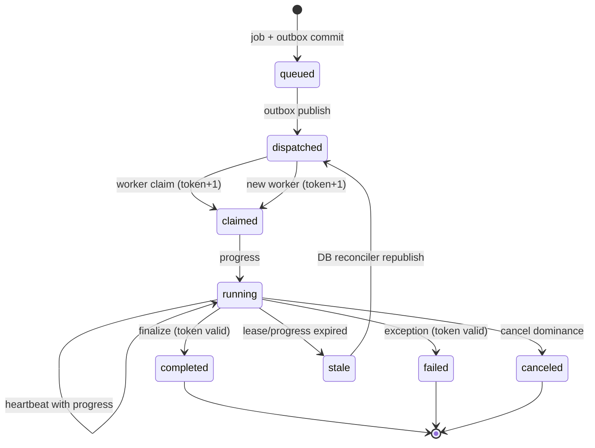

# Release 1 Celery and Redis Decision

Status: final architecture decision candidate. P0 has been executed. No P1+
implementation is authorized.

## 1. Decision summary

**PostgreSQL is the execution authority. Redis/Celery is transport.**

Release 1 must not treat Redis visibility as the recovery mechanism. It must:

- persist job state, ownership, lease and progress in Postgres;
- claim before execution;
- reject stale writes with a fencing token;
- renew the lease only while progress is real;
- detect expired leases from the database;
- re-dispatch abandoned running jobs through the durable outbox;
- let duplicate Celery messages be safe via claim/fencing;
- terminate a stuck worker process separately if it would otherwise occupy a
  slot forever.

## 2. P0 evidence

| Test | Result | Meaning |
|---|---|---|
| P0-13 | **FAIL** | Visibility 5 s did not redeliver a 10 s task while two solo workers were already running; Redis retained `unacked_index` for 18 s. |
| P0-13b | PASS | Starting a new worker restored the unacked task and produced a duplicate start. |
| P0-14 | PASS | SIGKILL + new worker produced a second start. |
| P0-15 | PASS | `self.retry` countdown 1 s executed twice. |
| P0-16 | PASS | 3 s hard limit killed the child; no normal end. |
| P0-18 | PASS | SIGTERM let a 5 s task finish in 4.6 s. |
| P0-AOF-01/02 | PASS | Redis AOF key and queued message survived restart. |

**Conclusion:** visibility is not a wall-clock recovery guarantee; a DB
lease-expiry re-dispatch reconciler is mandatory. Fencing prevents duplicate
writes, not duplicate starts or slot occupancy.

## 3. Authoritative lifecycle



### Original worker still running after replacement

- The reconciler re-dispatches only after lease/progress expiry.
- The new worker claims with `lease_token + 1`.
- The original worker's next guarded write finds 0 rows and must abort:
  - no checkpoint commit;
  - no terminal status;
  - no artifact pointer;
  - no S3 publication.
- Local artifacts are attempt-scoped; the original's writes are orphaned.
- S3 keys are attempt-scoped; the original's objects are not referenced.
- A stale original may still consume a worker slot until it checks the lease or
  is terminated. The DB row is safe; the slot is not.

## 4. Reconciler requirement

A P0-visible gap: a running job can be unacked and not redelivered while
workers are occupied. The reconciler must find:

```
jobs.status = 'running'
AND (jobs.lease_expires_at < now() - reaper_grace
     OR jobs.progress_at < now() - progress_timeout)
AND no active owner / token match
```

It must:

1. Re-read the row.
2. Publish a new `run_job` intent through the outbox (or a dedicated
   re-dispatch row).
3. Cap attempts and backoff to avoid loops.
4. Let the new task claim under the normal conditional update.
5. Never set `completed`/`failed` by itself unless it is the reaper path.
6. Record an event/metric.

The reconciler is required in Release 1 (P2/P6), not deferred. P0-13 is the
evidence.

## 5. Worker slot termination

Lease expiry does **not** terminate a process. Without a process-level limit,
a stuck worker can hold a slot forever even though the DB row is recovered.

Options:

| Mechanism | Effect | Trade-off |
|---|---|---|
| DB lease/reconciler | Recovers row; old process continues | Slot remains occupied |
| `task_soft_time_limit` | Raises in task; can checkpoint/exit | Needs handler; may not fire in C |
| `task_time_limit` | Kills child process | Healthy long task is killed/resumed |
| Orchestrator SIGKILL | Frees slot | External watchdog/complexity |

**Recommendation:** add a configurable high hard/soft runtime limit to
`run_job` after measuring production runtime. Until then, do not claim a stuck
slot is automatically freed. A hard limit is the only Celery-native way to free
a child process.

## 6. Runtime limits - not finalized

The 23 h/24 h proposal is **not approved**. P0 only proved a 3 s hard limit and
a 5 s SIGTERM warm shutdown.

Required measurements:

- distribution of legitimate job duration;
- longest legitimate silent stage;
- longest single chunk/finalization;
- worker slot occupancy and queue wait;
- recovery expectations;
- cost of killing/resuming a long job.

Policy options:

1. **No limit, DB reconciler only** - recovers row, not slot; accept manual
   intervention/restart risk.
2. **Hard cap (e.g., 24 h/attempt), soft just below** - bounds slot occupancy;
   healthy long jobs resume from checkpoint.
3. **Bounded execution units** - best fairness/recovery, larger refactor.

Recommendation: Option 2 after measurement; keep Option 3 as future. Do not
hard-code 23/24 h in P1.

## 7. Redis configuration

| Setting | Current | Recommendation | Status |
|---|---|---|---|
| Visibility timeout | unset (3600 default) | Explicit 3600; not recovery | Recommended |
| Broker AOF | on | Keep; capacity analysis | P0 passed AOF; capacity unproven |
| `maxmemory-policy` | not set | `noeviction` + headroom | Requires capacity measurement |
| Result expiry | 3600 | `ignore_result` for `run_job` or > max runtime | Recommended |
| `acks_late` | True | Keep | Verified |
| `task_reject_on_worker_lost` | True | Keep | Verified |
| `worker_prefetch_multiplier` | 1 | Keep | Verified |
| `task_acks_on_failure_or_timeout` | default True | Explicit True | Recommended |
| Hard/soft limits | unset | Configurable after measurement | Business decision |
| Docker stop grace | default | 60-120 s | Deployment decision |

Do not set visibility to 24 h as a substitute for DB recovery; it increases
unacked retention and still does not guarantee recovery.

## 8. Options comparison (updated with P0)

| Option | Reliability | Recovery | Duplicate risk | Slot use | Effort | Decision |
|---|---|---|---|---|---|---|
| A: long task + visibility only | Low | waits/poll-dependent | high at startup/visibility | long | Low | Reject |
| B: bounded units | High | fast | low | fair | High | Future |
| C: DB-authoritative + reconciler | High | ~lease TTL | low writes; duplicate starts possible | long | Medium | **Recommended** |

## 9. Configuration decision

**D9 final recommendation:** Option C + explicit visibility 3600 + DB
lease-expiry re-dispatch + hard/soft runtime limit after measurement +
`ignore_result`/longer expiry + noeviction/AOF capacity review.

**P1 impact:** none. P1 only adds schema/state; no Celery/Redis runtime change.
P2/P6 implement the reconciler and fencing. Production Redis changes require
capacity/persistence evidence.
