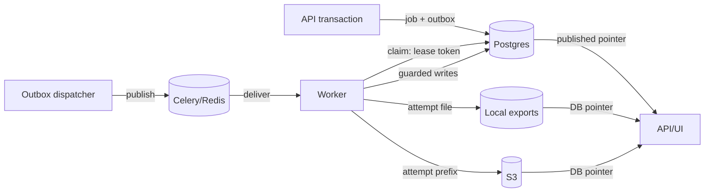

# Release 1 Design: Worker Ownership and State Integrity

Status: **design only**. Nothing in this document has been implemented. No
application source, schema, migration, API, dependency, or deployment file was
changed.

Audience: implementer and approver.
Companion documents:

- [`WORKER_OWNERSHIP.md`](./WORKER_OWNERSHIP.md) - ownership phases, claim,
  heartbeat, reaper, rollup, scenarios A-F.
- [`LEASE_AND_FENCING.md`](./LEASE_AND_FENCING.md) - exact schema, SQL,
  transaction model, migration and backfill.
- [`ARTIFACT_PUBLICATION.md`](./ARTIFACT_PUBLICATION.md) - attempt-scoped local
  artifacts, distinct stores, S3 publication and cleanup.
- [`OUTBOX_AND_DISPATCH.md`](./OUTBOX_AND_DISPATCH.md) - transactional outbox,
  dispatcher, Celery acknowledgement/redelivery, orphan recovery.
- [`RELEASE_1_TEST_PLAN.md`](./RELEASE_1_TEST_PLAN.md) - concrete tests and
  acceptance criteria.
- [`RELEASE_1_DEPLOYMENT.md`](./RELEASE_1_DEPLOYMENT.md) - phased rollout,
  flags, mixed versions, rollback.
- [`RELEASE_1_ARCHITECTURE_DECISIONS.md`](./RELEASE_1_ARCHITECTURE_DECISIONS.md) -
  independent challenge review, revised decisions, failure-mode analysis.

## Legend

| Tag | Meaning |
|---|---|
| **[V]** | Verified in the repository on 2026-11-14. |
| **[P]** | Proposed architecture. Not implemented. |
| **[A]** | Unverified assumption requiring confirmation. |
| **[D]** | Decision requiring explicit approval. |

## 1. Executive summary

Release 1 makes one job row safe to execute by at most one worker at a time,
makes every terminal transition check ownership, makes cancellation dominant
over completion, and makes dispatch and artifact publication durable.

The design has five cooperating mechanisms:

1. **Per-job lease with a monotonic fencing token.** A claim is one conditional
   `UPDATE ... RETURNING`; every later worker write includes the owner id, the
   lease token, the lease expiry, and the allowed source statuses.
2. **Progress-aware heartbeat.** A separate thread renews the lease only while
   the main execution loop is making progress. A hung process cannot hold a
   job forever.
3. **Attempt-scoped artifacts.** Each execution attempt writes to its own local
   files and S3 prefix. The database pointer is the publication commit. A stale
   worker cannot corrupt a newer attempt's bytes, even if it is still running.
4. **Transactional outbox for dispatch.** The job row and its dispatch intent
   commit together. A dispatcher publishes with retries; duplicate messages are
   harmless because the worker claim is the execution gate.
5. **Schedule ledger and minimum completeness.** A `schedule_windows` row
   tracks each owed window; `completion_state`/`gap_count`/`gap_reason` prevent
   skipped data from being reported as clean success.

Explicit control phases remain: `paused`, `canceling`, `canceled`, `completed`
and `failed` are defined by status plus owner/request fields. `claimed` and
`running` are phases of `status='running'`; `pausing`/`canceling` are derived
from an owner still being present. The public six-status vocabulary is
unchanged; `phase`/`is_finalizing` are additive API fields.

Release 1 does **not** add a state-machine library, a new queue, HTTP
idempotency keys, or a richer completeness taxonomy. It does include the
minimum rewrite of schedule recovery and completeness needed to avoid incorrect
success reporting.

## 2. Verified current execution flow

### 2.1 End-to-end path

| Step | Verified behavior | Code |
|---|---|---|
| 1. Validate and insert | API validates credential/index/S3, inserts `Job(status="queued")`, audits, commits. | `api/app/routers/jobs.py:263-327` |
| 2. Publish | `dispatch_job()` calls Celery `send_task("logvault.run_job", args=[job_id])` **after** the commit, outside the transaction. | `api/app/tasks_client.py:17-22`; `jobs.py:324-327` |
| 3. Batch/group publish | All rows commit, then each job is dispatched in a loop. A publish failure aborts later dispatches. | `jobs.py:474-478`; `groups.py:216-225` |
| 4. Task entry | `run_job` checks disk, loads the job to decide rollup vs extraction, then calls the runner. | `worker/app/tasks.py:139-177` |
| 5. Redelivery flag | Celery `current_task.request.redelivered` is passed as `reclaim=True`. | `tasks.py:153-174` |
| 6. Claim | `claim_job` conditionally moves `queued` to `running`, or reclaims a quiet `running` job when redelivered. It sets `started_at` and clears `error_message`. | `worker/app/db.py:193-230` |
| 7. Load and validate | The runner loads job/credential/index and, before claiming, can fail a job with `missing credential/index`. | `worker/app/runner.py:201-244` |
| 8. Checkpoint load | `checkpoint`, `file_offset`, `chunk_hours` are restored; a new distinct store is created or the existing one is opened. | `runner.py:271-334` |
| 9. Write loop | Rows stream to the CSV/JSONL, chunk boundaries flush and fsync, then update job counters/checkpoint and insert an event in one transaction. | `runner.py:400-664` |
| 10. Pause/cancel poll | Status is read every 10 s between rows and at chunk boundaries. `paused`/`canceled` raises `_Stopped`. | `runner.py:54-57`, `631-652` |
| 11. Terminal write | Pause/cancel/failure/completion writes status unconditionally by `job_id`. | `runner.py:667-722`, `830-895` |
| 12. S3 | Inline upload before `completed`; per-artifact errors are stored on the job; the job still completes. | `runner.py:795-839`; `worker/app/s3.py:127-179` |
| 13. Reaper | Beat scans `running` jobs whose newest event (or `started_at`) is older than `stale_job_minutes` and writes `failed`. | `worker/app/scheduler.py:192-249` |
| 14. Rollup | `run_rollup` writes `running` unconditionally, merges source stores, writes `completed` unconditionally. | `worker/app/rollup.py:80-86`, `228-241` |
| 15. Schedule scan | Beat computes owed windows, checks `_already_extracted`, inserts jobs, updates `last_run_at`, then dispatches after commit. | `worker/app/scheduler.py:61-189` |
| 16. Retry | API creates a **new** job; it copies `created_by`/`rollup_of`/S3 but not `checkpoint` or `group_id`. | `jobs.py:953-1003` |
| 17. S3 retry | API requires `completed`, dispatches `upload_job_s3`; no attempt lock or pending state. | `jobs.py:488-507`; `tasks.py:180-228` |

### 2.2 Transaction boundaries

- API routes use an ORM `Session` (`autocommit=False`) and explicit `commit()`
  **[V]** (`api/app/database.py`).
- Worker writes use SQLAlchemy Core through `engine.begin()` per write
  **[V]** (`worker/app/db.py:185-186`; `runner.py:626-630`).
- Claim is a single conditional `UPDATE ... RETURNING` and is atomic on
  Postgres **[V]** (`db.py:224-230`).
- There is **no** transaction spanning the job insert and broker publish
  **[V]**.
- There is **no** owner, lease, fencing token, or attempt identifier on the job
  row **[V]**.
- There is **no** unique constraint on `(created_by, start_epoch)` for schedule
  jobs **[V]** (`models.py:44-97`; migrations 0001-0031).
- `updated_at` is an ORM `onupdate` column; worker Core writes do not move it
  **[V]** (`models.py:93-95`; `scheduler.py:202-204`).

### 2.3 Deployment facts that affect the design

- Production runs the API with four uvicorn workers **[V]**
  (`docker-compose.prod.yml:14-15`; `install-prod.sh:337`).
- Production runs **one** worker service with embedded beat (`celery worker
  -B`) and `worker_concurrency=4` **[V]** (`docker-compose.yml:61-86`;
  `docker-compose.prod.yml:18-23`; `celery_app.py:20-31`).
- The runbook explicitly documents `docker compose up -d --scale worker=N`,
  which would run **N beat schedulers** because each worker has `-B`
  **[V]** (`RUNBOOK.md:63-65`). The schedule ledger, scan lock, and dedicated
  beat are correctness and operability requirements.
- Redis is both the broker and the result backend. Celery 5.4's Redis
  visibility timeout defaults to **3600 s** **[V]** (official Celery 5.4
  docs), and no `visibility_timeout` is configured in `celery_app.py` **[V]**.
  Long jobs can therefore be redelivered while still running. The design treats
  duplicate delivery as normal and safe.
- `task_acks_late=True`, `task_reject_on_worker_lost=True`,
  `worker_prefetch_multiplier=1` **[V]** (`celery_app.py:20-28`).
- No `task_time_limit`/`task_soft_time_limit` is configured **[V]**. A hung
  process can hold a worker slot indefinitely; the revised design requires a
  high runtime limit or an explicit accepted risk (D9).
- Migrations run before services are recreated by `deploy.sh` **[V]**
  (`deploy.sh:21-27`). The API does not migrate at startup.

## 3. Release 1 scope

### 3.1 In scope

- Lease-based worker ownership with a monotonic fencing token.
- Progress-aware heartbeat and guarded every-write ownership validation.
- Cancel dominance, safe pause/resume, and a derived `phase`/`is_finalizing`.
- Reaper/lease/progress interaction and orphan-owner cleanup.
- Rollup execution through the same lifecycle.
- Attempt-scoped local artifacts and distinct stores.
- S3 attempt-scoped publication and cleanup.
- Transactional outbox and dispatcher.
- `schedule_windows` ledger and dedicated beat with a scan lock.
- Minimum `completion_state`/`gap_count`/`gap_reason` and group/report partial
  propagation.
- Retry/checkpoint consistency (decision D3).
- Explicit Celery/Redis settings and a runtime-limit decision.
- Tests, deployment, rollback, monitoring.

### 3.2 Out of scope (Release 2+)

- Richer completeness taxonomy and historical gap backfill beyond the
  unambiguous skipped-batch pattern.
- HTTP create-idempotency keys.
- Per-credential token-refresh lock and rotation CAS.
- Login/OAuth/health/notification state hardening.
- Comparison run `running` persistence.
- A state-machine library.
- A new broker or queue.
- Rewriting the scheduler as cron.

**Important:** Release 1 prevents *wrong terminal status*, *concurrent
writers*, and *partial data reported as clean success*. It does not solve
duplicate *job creation* after a lost HTTP response; that needs an idempotency
key and is deferred.

## 4. Target architecture

### 4.1 Three safety planes

1. **Ownership plane:** `owner_id`, `lease_token`, `lease_expires_at`,
   `heartbeat_at`. Every worker DB write validates all four.
2. **Artifact plane:** attempt-scoped local and S3 paths. The database pointer
   (`output_file_path`, `store_path`, `s3_*`) is the publication commit. A stale
   attempt cannot overwrite a newer pointer.
3. **Dispatch plane:** `job_dispatch_outbox`. Job insert and dispatch intent
   commit together. Delivery is at-least-once; execution is at-most-once via the
   claim.

### 4.2 Lifecycle phases

The public `status` vocabulary remains `queued`, `running`, `paused`,
`completed`, `failed`, `canceled`. The user-visible phases are derived:

| Phase | Persisted representation | Owner required? |
|---|---|---|
| Queued | `status='queued'`, `owner_id IS NULL` | No |
| Claimed | `status='running'`, `owner_id` set, token > 0, no progress yet | Yes |
| Running | `status='running'`, `owner_id` set, progress may exist | Yes |
| Pausing | `status='paused'`, `pause_requested_at` set, `owner_id` non-null | Yes |
| Paused | `status='paused'`, `owner_id IS NULL` | No |
| Cancelling | `status='canceled'`, `cancel_requested_at` set, `owner_id` non-null | Yes |
| Cancelled | `status='canceled'`, `owner_id IS NULL`, `finished_at` set | No |
| Completed | `status='completed'`, `owner_id IS NULL`, `finished_at` set | No |
| Failed | `status='failed'`, `owner_id IS NULL`, `finished_at` set | No |

`claimed` and `running` are not separate statuses. `pausing` and `canceling`
are not separate statuses. This preserves API/UI compatibility and avoids
adding two words to the 14+ status sets. `JobOut` adds a derived `phase` and
`is_finalizing` (`owner_id` non-null while paused/canceled); download URLs are
withheld while finalizing.

### 4.3 Ownership invariants

1. A job has at most one owner.
2. A claim increments `lease_token`; the token is monotonically increasing per
   job.
3. Every worker write requires `owner_id`, `lease_token`,
   `lease_expires_at > now()`, and an allowed source status.
4. A write that affects 0 rows means the worker is fenced. It must abort; it
   must not write a terminal status, publish S3, or update the checkpoint.
5. Heartbeat renewal is the only write allowed to extend an expired lease. It
   is itself token-guarded and races safely with a claim.
6. Cancel is dominant: if `cancel_requested_at` is set or the row is
   `canceled`, the terminal status is `canceled`, never `completed`.
7. Resume and reclaim increment the token, so the previous worker is fenced
   even if it has not yet observed the pause/reclaim.
8. A terminal/paused row has no owner. The token remains as the last epoch for
   audit.

### 4.4 Artifact publication invariants

1. An attempt writes only to paths containing its token
   (`job_<id>.a<token>.*`, `job_<id>.a<token>.distinct.sqlite`).
2. The database pointer is set only by a lease-guarded write.
3. A stale attempt's files are never referenced; they are cleanup candidates.
4. A new attempt seeds its local artifact from the previous checkpoint's
   `artifact_path` up to `file_offset`; it does not append to a file another
   process may still write.
5. S3 objects are written under an attempt-specific prefix. The database
   `s3_published_attempt`/URIs decide which attempt is current.
6. DB fencing alone does **not** protect S3 or local files; unique paths are
   required.

### 4.5 Dispatch invariants

1. A job row and its dispatch intent are inserted in one transaction.
2. A dispatcher may publish the same intent more than once; the worker claim is
   the execution gate.
3. A published message that is lost after the outbox mark is recovered by a
   queued-job reconciliation.
4. A duplicate delivery either claims (if queued or lease expired), waits
   (redelivered but lease valid), or exits (terminal/owned).
5. No API route depends on the broker being reachable to return a committed
   job.

## 5. Design decisions requiring approval

| ID | Decision | Recommendation | Alternative | Why it matters |
|---|---|---|---|---|
| D1 | Cancel representation | Keep `status='canceled'` immediately for compatibility; add derived `phase='canceling'`/`is_finalizing`; internal truth is `cancel_requested_at` + owner + token. Withhold downloads while finalizing. | Persisted `canceling` status; or leave status running until ack. | Immediate status alone is ambiguous to consumers; derived phase resolves it without expanding the six-status vocabulary. |
| D2 | Pause representation | Keep `status='paused'` immediately; add derived `phase='pausing'`; internal truth is `pause_requested_at` + owner. Resume clears owner and bumps the token. | Persisted `pausing`; or leave running until ack. | Preserves compatibility and lets the worker persist the current chunk before stopping. |
| D3 | Retry semantics | **Resume only with validated checkpoint + artifact + store; otherwise restart from zero with a recorded reason.** Rollups always restart the merge. Add `retry_of`. | Always restart; always resume. | Prevents a tail-only artifact. The runbook/reaper message must match the chosen behavior. |
| D4 | Attempt-scoped local artifacts | **Yes.** New attempt writes a new file and seeds the committed prefix. | Canonical path + lease checks. | DB fencing cannot stop a stale process from appending to a shared CSV. |
| D5 | Attempt-scoped distinct store | **Yes.** Add `jobs.store_path`; merge the previous store **and preserve `last_chunk_committed`**. | Canonical store; or disable aggregation resume. | A stale worker can corrupt SQLite; merging without the marker double-counts a replayed chunk. |
| D6 | Dispatch mechanism | **Transactional outbox + inline fast path + queued reconciliation.** | Queued-job sweeper only. | Commits intent with the job; duplicate messages are safe via claim. HTTP create idempotency is Release 2. |
| D7 | S3 publication | **Unique attempt prefix + DB pointer + manifest.** Never overwrite a shared key; add `s3_published_with_error`. | Stable canonical key with conditional writes. | S3 has no multi-object transaction; conditional writes are not universal. |
| D8 | Lease timing | `LEASE_TTL=600s`, heartbeat **60s**, reclaim grace `60s`, **progress timeout 1800-3600s**, **reaper grace 60s**. Use DB time. | 300s/60s; or heartbeat-only liveness. | 600/60 tolerates 10 missed beats; progress timeout prevents a hung main loop from renewing forever; reaper grace avoids another 60-minute delay. |
| D9 | Celery/Redis | Explicit `visibility_timeout=3600`; keep `acks_late`/reject-on-lost/prefetch 1; bounded `self.retry` (<=300s, max 3); `ignore_result` or longer result expiry; high soft/hard runtime limit **or** accepted stuck-slot risk. | Broker default; no time limit. | Long jobs are redelivered hourly; a hung task can hold a slot forever; result state expires in 1h. |
| D10 | Completeness | **Include minimum `completion_state`/`gap_count`/`gap_reason` in Release 1; propagate `partial` to group/report.** Defer richer taxonomy. | Defer all completeness. | Otherwise skipped batches and rollup skips still report clean success, contradicting the release objective. |
| D11 | Schedule recovery | **Add `schedule_windows` ledger**: failed/missing/duplicate/backfill/retry/dispatch/success; one active job per window. | Unique jobs index only. | A unique index prevents duplicates but never retries a failed window or tracks a missing one. |
| D12 | Beat topology | **Dedicated single `celery beat` + scan lock; ledger/outbox unique keys as backstop.** | Mandate one `-B` worker only. | Deployment overlap/crash can leave zero or multiple beats; a lock + ledger enforces correctness. |
| D13 | Status constraints | Audit first; add CHECKs for `jobs.status`, `completion_state`, `schedule_windows.status` when clean; no strict owner check in the first rollout. | Add blindly; or never add. | Legacy values fail migrations; mixed old/new code uses the same six statuses, so the CHECK is safe when the audit is clean. |

## 6. Milestones

Each milestone is independently deployable and has a rollback. M1 is the
prerequisite for all others; M2/M3/M6/M7 depend on M1; M4 can run in parallel
with M2 but should deploy after M1 in environments where duplicate messages are
possible.

### M0 - Baseline, flags, and observability

- **Objective:** make the current flow measurable before changing it.
- **Files:** `api/app/config.py`, `worker/app/config.py`, new metrics/log
  helper (proposal), `worker/app/runner.py`, `worker/app/tasks.py`,
  `worker/app/scheduler.py`, `api/app/routers/jobs.py` (logging only).
- **DB changes:** none.
- **Dependencies:** none.
- **Complexity:** Low.
- **Risk:** Low (log/metric overhead).
- **Tests:** transition log fields present; metric increments on claim/terminal.
- **Acceptance:** every claim, pause, resume, cancel, terminal, reaper, and
  outbox attempt emits a structured log with `job_id`, trigger, from/to, owner,
  token.
- **Rollback:** remove logging/metrics.

### M1 - Lease, fencing, control phases, and minimum completeness

- **Objective:** one owner per job; every worker write is fenced; cancel is
  dominant; pause/resume cannot create two writers; a hung main loop cannot
  renew forever; known gaps are recorded.
- **Files:** new `worker/app/lease.py` (proposal), `worker/app/db.py`,
  `worker/app/runner.py`, `worker/app/tasks.py`, `worker/app/scheduler.py`,
  `worker/app/config.py`, `api/app/models.py`, `api/app/routers/jobs.py`,
  `api/app/routers/groups.py`, `api/app/schemas.py`, migration
  `0032_job_ownership_and_completion.py`.
- **DB changes:** `owner_id`, `lease_token`, `lease_expires_at`,
  `heartbeat_at`, `progress_at`, `cancel_requested_at`,
  `pause_requested_at`, `completion_state`, `gap_count`, `gap_reason`; index
  `(status, lease_expires_at)` and `(status, progress_at)`.
- **Dependencies:** none (first).
- **Complexity:** High.
- **Risk:** High if enforced before all workers are upgraded. Use
  `JOB_LEASE_MODE=observe` first.
- **Tests:** concurrent claims, fencing, stale writes, cancel race,
  pause/resume race, progress timeout, reaper, crash recovery, completion
  classification (see test plan T1-T12, T18-T20, T29).
- **Acceptance:**
  - exactly one claim wins;
  - a stale token write affects 0 rows and the worker aborts;
  - cancel always ends `canceled`, never `completed`;
  - resume bumps the token and the old worker cannot write;
  - a heartbeat with no progress stops renewing at the progress timeout;
  - `progress_at` does not advance on a heartbeat alone;
  - reaper can fence on stale `progress_at` even if a heartbeat was renewed;
  - reaper only fails expired leases, with a short grace;
  - every worker write has a rowcount check;
  - a clean run is `completion_state='complete'`; a skipped-batch run is
    `partial` with a gap count.
- **Rollback:** set `JOB_LEASE_MODE=off`, `JOB_CANCEL_FENCE=off`, revert worker
  and API; leave columns. Unsafe if the API still bumps tokens while old
  workers run; see deployment section.

### M2 - Attempt-scoped local artifacts and checkpoint/resume

- **Objective:** no two attempts can write the same local bytes; resume copies
  only the committed prefix; the DB pointer is published under the lease.
- **Files:** `worker/app/runner.py`, `worker/app/rollup.py`,
  `worker/app/last9/checkpoint.py`, `worker/app/last9/extract.py` (only if the
  checkpoint contract changes), `worker/app/last9/distinct_store.py`,
  `worker/app/db.py`, `api/app/models.py`, `api/app/routers/jobs.py`
  (download/delete), `api/app/routers/customers.py` (artifact cleanup),
  `api/app/routers/groups.py`, `api/app/routers/reports.py`,
  `api/app/schemas.py`, `web/lib/api.ts`, `web/app/jobs/page.tsx`,
  `web/app/jobs/[id]/page.tsx`, `worker/app/scheduler.py` (cleanup), migration
  `0033_job_artifact_paths.py`.
- **DB changes:** `jobs.store_path` (text, null). No change to
  `output_file_path` type.
- **Dependencies:** M1.
- **Complexity:** High.
- **Risk:** Medium-High (resume correctness, store merge, orphan cleanup).
- **Tests:** crash at each checkpoint step, missing/truncated artifact, resume
  CSV prefix, distinct-store merge marker, pause/resume, download of the
  published pointer, orphan cleanup, group/report partial propagation.
- **Acceptance:** after a crash at any point, the resumed job contains every
  committed row exactly once and no uncommitted row; the published path always
  belongs to the current/winning attempt; a stale attempt cannot change the
  pointer; a partial child makes the group/report day `partial`; the job list and
  detail show a partial badge, not only "completed".
- **Rollback:** set `ARTIFACT_ATTEMPT_PATHS=off`; old code uses
  `output_file_path` (still valid). Attempt store rollback needs a copy/link
  shim for `store_path`; see deployment.

### M3 - Rollup lifecycle enforcement

- **Objective:** rollups use the same claim/lease/cancel/finalization as
  extraction; duplicate dispatch and cancel are safe.
- **Files:** `worker/app/rollup.py`, `worker/app/tasks.py`,
  `worker/app/scheduler.py`, `worker/app/db.py`.
- **DB changes:** none beyond M1/M2 (`store_path`).
- **Dependencies:** M1, M2 (source store path).
- **Complexity:** Medium.
- **Risk:** Medium (month-end correctness; partial source policy).
- **Tests:** duplicate rollup dispatch, cancel during merge, fenced old merge,
  missing source store, source status filtering.
- **Acceptance:** one rollup writer; cancel stays canceled; a fenced rollup
  cannot publish outputs; skipped sources produce an error/warn signal.
- **Rollback:** revert `run_rollup` to the old unconditional path only after
  the API stops cancel-fencing rollups; otherwise keep M3.

### M4 - Transactional outbox and dispatcher

- **Objective:** job insert and dispatch intent commit together; broker outages
  do not orphan committed jobs; duplicate messages are safe.
- **Files:** `api/app/routers/jobs.py`, `api/app/routers/groups.py`,
  `api/app/tasks_client.py`, new `api/app/outbox.py` (proposal),
  `worker/app/scheduler.py` or new `worker/app/dispatcher.py`,
  `worker/app/celery_app.py` (beat schedule), `api/app/models.py`,
  `api/app/config.py`, `worker/app/config.py`, migration
  `0034_job_dispatch_outbox.py`.
- **DB changes:** `job_dispatch_outbox` table, unique `(job_id, task_name)`,
  due index.
- **Dependencies:** M1 for duplicate-safety; can be developed in parallel.
- **Complexity:** Medium.
- **Risk:** Medium (at-least-once semantics; mixed API versions).
- **Tests:** broker down, crash after publish before mark, duplicate publish,
  batch/group atomicity, queued orphan recovery, outbox retry/backoff.
- **Acceptance:** a committed job is eventually published; a duplicate message
  causes at most one execution; a batch either commits all jobs+outbox rows or
  none; a failed outbox is visible.
- **Rollback:** set `DISPATCH_MODE=direct`; keep the table; drain or leave
  pending rows. Old API direct dispatch still works.

### M5 - Schedule ledger, recovery, and beat singleton

- **Objective:** every owed window is tracked independently of a job; failed,
  missing, duplicate, and backfill windows are recoverable; only one beat
  scans.
- **Files:** `worker/app/scheduler.py`, `worker/app/rollup.py`,
  `api/app/models.py`, `api/app/routers/reports.py`,
  `api/app/routers/schedules.py`, `worker/app/celery_app.py`, migration
  `0035_schedule_windows.py`, `RUNBOOK.md`, deployment docs.
- **DB changes:** `schedule_windows` table (`window_key`, `scheduled_for`,
  `status`, `completion_state`, attempts, `config_snapshot`);
  `jobs.schedule_window_id`, `jobs.attempt_no`; unique window/attempt and
  one-active-job indexes.
- **Dependencies:** M4 (outbox rows in the same transaction).
- **Complexity:** High.
- **Risk:** Medium-High (new reporting source, retry policy, mixed old/new beat).
- **Tests:** concurrent scans, window retry/backoff, missing window, duplicate
  window, backfill cap, dispatch failure, success tracking, one beat/scan lock.
- **Acceptance:** one window row per `(schedule, window_key)` and at most one
  active job per window; a failed window is retried with capped attempts or
  explicitly reported; a completed window is never retried; a partial window is
  `completed`+`partial`, not auto-retried; two beat scans cannot create duplicate
  work; `last_success_at` is derived from completed windows; reports/rollups use
  the successful attempt per window, not every terminal job; schedule edits
  affect future windows; schedule delete cancels pending windows without losing
  history; calendar-day windows are UTC; interval windows use a fixed slot key.
- **Rollback:** set `SCHEDULE_WINDOWS_ENABLED=false`; keep the table; fall back
  to the legacy job-based schedule/report path; keep one beat.

### M6 - S3 attempt-scoped publication

- **Objective:** concurrent S3 uploads cannot overwrite each other; the DB
  pointer identifies the winning attempt; abandoned objects are cleanable.
- **Files:** `worker/app/s3.py`, `worker/app/tasks.py`,
  `worker/app/runner.py`, `api/app/routers/jobs.py`, `api/app/models.py`,
  `api/app/schemas.py`, `worker/app/scheduler.py` (cleanup), migration
  `0036_s3_attempt_publication.py`.
- **DB changes:** `s3_attempt_token`, `s3_uploading_at`,
  `s3_published_attempt`, `s3_manifest_uri`.
- **Dependencies:** M1 (inline fence), M2 (local artifact paths).
- **Complexity:** Medium-High.
- **Risk:** Medium (S3 partial success, cleanup).
- **Tests:** two concurrent retries, stale attempt publish, partial artifact,
  cleanup of unpublished prefixes, manifest integrity.
- **Acceptance:** only one attempt publishes the DB pointer; stale attempt
  objects are never referenced; partial success is visible; retry is
  idempotent.
- **Rollback:** set `S3_ATTEMPT_FENCING=off`; old code reads `s3_uri` and
  ignores the new fields. Old attempt objects remain; cleanup can be deferred.

### M7 - Retry and checkpoint consistency

- **Objective:** retry behavior matches the documented behavior and the reaper
  message.
- **Files:** `api/app/routers/jobs.py`, `api/app/routers/groups.py`,
  `worker/app/runner.py`, `worker/app/last9/checkpoint.py`,
  `worker/app/scheduler.py` (message), web job page (copy). No new migration;
  `retry_of` is added by `0032`.
- **DB changes:** `retry_of` (integer, null) is added in `0032`; optional
  checkpoint JSON keys (`artifact_path`, `store_path`, `attempt_token`).
- **Dependencies:** M2.
- **Complexity:** Medium (resume) / Low (restart).
- **Risk:** Medium if resume; Low if restart.
- **Tests:** valid checkpoint resume, missing artifact fallback, canceled job
  retry, group retry lineage, `retry_of` link.
- **Acceptance:** retry either resumes exactly once from the committed prefix
  or restarts with a clear event/message; never silently mixes a stale
  artifact.
- **Rollback:** set `RETRY_MODE=restart`; keep `retry_of`.

### M8 - Hardening, constraints, chaos, docs

- **Objective:** lock the invariants and make the release operable.
- **Files:** migration `0037_status_constraints.py`, tests, `RUNBOOK.md`,
  `docs/*`, metrics dashboards.
- **DB changes:** `CHECK` on `jobs.status`, `completion_state`,
  `schedule_windows.status` after audit; optional indexes.
- **Dependencies:** all.
- **Complexity:** Medium.
- **Risk:** Low-Medium.
- **Tests:** full matrix, chaos, mixed-version simulation, performance.
- **Acceptance:** all acceptance criteria pass; runbook updated; alerts live.
- **Rollback:** drop the constraints; keep code.

## 7. Database change summary

| Object | Change | Additive? | Risk |
|---|---|---|---|
| `jobs` | owner/lease/heartbeat/progress/cancel/pause fields | Yes | Low; nullable/default |
| `jobs` | `completion_state`, `gap_count`, `gap_reason` | Yes | Low; default `unknown`/0 |
| `jobs` | `store_path`, `retry_of` | Yes | Low |
| `jobs` | S3 attempt fields | Yes | Low |
| `jobs` | `schedule_window_id`, `attempt_no` | Yes | Low; nullable for manual jobs |
| `schedule_windows` | new ledger table | Yes | Medium; new recovery source |
| `job_dispatch_outbox` | new table | Yes | Low |
| `jobs` | status/completion CHECK | Constraint | Medium; audit first |
| indexes | lease, outbox due, one-active-window | Yes | Low-Medium; use concurrent creation where possible |

Full SQL, field rationale, migration order, and backfill: see
[`LEASE_AND_FENCING.md`](./LEASE_AND_FENCING.md) and
[`OUTBOX_AND_DISPATCH.md`](./OUTBOX_AND_DISPATCH.md).

## 8. Compatibility summary

- **API:** status vocabulary unchanged; new fields are additive; `JobOut` adds
  `phase`/`is_finalizing`, `completion_state`, `gap_count`, `gap_reason`.
  Create still returns 201. Retry behavior changes only behind `RETRY_MODE`.
- **Worker:** old workers ignore new columns; they can still claim queued jobs.
  Mixed versions are unsafe for fencing and must be sequenced (see deployment).
- **Web:** old pages ignore new fields; the status maps keep working.
- **DB:** all application migrations are additive except the constraints; the
  status/completion CHECK requires an audit. The schedule ledger is a new
  recovery source, not a replacement for job history.
- **On-disk:** attempt paths are opaque to the API/download; old code reading
  `output_file_path` still works. Old rollup reading canonical
  `job_<id>.distinct.sqlite` does **not** see attempt stores; rollback needs a
  shim (see deployment).

## 9. Testing and deployment summary

- Concurrency tests require Postgres. The current API tests use in-memory
  SQLite **[V]** (`api/tests/conftest.py`), and worker tests use SQLite
  **[V]** (`worker/tests/conftest.py`). SQLite cannot reproduce row-level
  concurrency faithfully. Add a Postgres test profile without adding a new
  library (use the existing `psycopg`/SQLAlchemy stack).
- The test matrix covers all scenarios A-F, S3 races, outbox, schedule
  duplicates, checkpoint crashes, and mixed-version flags. See
  [`RELEASE_1_TEST_PLAN.md`](./RELEASE_1_TEST_PLAN.md).
- The rollout uses `observe` mode, then enforcement, then cleanup. See
  [`RELEASE_1_DEPLOYMENT.md`](./RELEASE_1_DEPLOYMENT.md).

## 10. Final architectural review

### 10.1 Unresolved decisions

1. **D1/D2:** Keep the immediate `paused`/`canceled` status, or introduce
   `pausing`/`canceling` as persisted states? The design recommends derived
   phases.
2. **D3:** Retry resume vs restart. The design recommends resume with a
   validated fallback.
3. **D4/D5:** Attempt-scoped artifacts in Release 1 or defer. The design
   recommends yes; without them the local-file/S3 corruption window remains.
4. **D6:** Outbox table vs queued sweeper. The design recommends outbox with an
   inline fast path.
5. **D7:** S3 unique-prefix + DB pointer vs stable canonical key. The design
   recommends unique prefixes.
6. **D8:** Lease timings. The revised design recommends 600/60/60 plus a
   progress timeout and reaper grace.
7. **D9:** Celery visibility/retry/time limits. The revised design recommends
   explicit visibility 3600, bounded retry, and a high runtime limit or an
   accepted stuck-slot risk.
8. **D10:** Completeness. The revised design includes the minimum completeness
   fields in Release 1.
9. **D11:** Schedule recovery. The revised design includes a schedule ledger;
   this is a scope decision.
10. **D12:** Beat topology. The revised design recommends a dedicated beat plus
    a scan lock and ledger/outbox backstop.
11. **D13:** Status/completion CHECK timing. The revised design recommends
    after the preflight audit.
12. **Download gating:** Should `download_url` be withheld while
    `owner_id IS NOT NULL` (pausing/canceling) to avoid handing out an
    in-flight file? The design recommends yes for `paused`/`canceled`.

### 10.2 Assumptions requiring verification

- Postgres 16 and default READ COMMITTED are in use **[A]**; the conditional
  UPDATE model relies on row-level locking, which is standard.
- Celery 5.4's Redis `visibility_timeout` default is 3600 s **[V]**; confirm the
  deployed Redis/Celery behavior and set it explicitly.
- The `exports` volume is a normal local/block filesystem with consistent
  `fsync`/`rename` semantics, not NFS with weak cache coherence **[A]**.
- S3-compatible storage supports unique keys and `ListObjects` for cleanup;
  conditional writes are not assumed **[A]**.
- No external consumer relies on the exact on-disk `job_<id>.csv` path; the API
  download name is computed independently **[A]**.
- The worker is deployed as one container/process set; if scaled, the beat
  duplication warning applies **[V]**.
- The API and worker share the same database and timezone semantics; lease
  comparisons use DB time **[A]**.

### 10.3 Conflicts with existing behavior

| Existing behavior | Proposed change | Compatibility impact |
|---|---|---|
| API `cancel` writes `canceled` and returns immediately; worker may still write | Keep immediate `canceled`, add `cancel_requested_at`, derived `phase='canceling'`; worker writes `canceled` only | Same status; new phase field is additive |
| API `pause` writes `paused` immediately; worker notices within 10 s | Keep `paused`, add `pause_requested_at`, derived `phase='pausing'` | Same status; phase field is additive |
| Resume writes `queued` and dispatches | Also clear owner and bump token | Old worker is fenced; this is the fix |
| Rollup writes `running` unconditionally | Claim via lease; poll cancel | A canceled rollup now stops |
| `error_message` only for gaps | Add `completion_state`/gap fields; group/report show `partial` | Additive API fields; partial status changes reporting |
| Beat scans directly create jobs | `schedule_windows` ledger + outbox + scan lock | New ledger; legacy jobs fall back |
| Reaper uses event age | Lease + progress timeout; event fallback behind a flag | Mixed-version rollout must use the fallback |
| Retry creates a new job without checkpoint | Resume with checkpoint when valid (D3) | Behavior change; flag |
| Retry drops `group_id` | Copy it or expose "retry in group" | Group counts improve |
| Preview promotion drops S3/group/exclusions | Server-side promotion or copy all fields | Behavior change; separate UI work |
| S3 upload before `completed` | Finalize locally, then deliver S3 with an attempt token | S3 failure no longer delays completion; UI shows pending |
| Canonical `job_<id>.csv` path | Attempt-scoped path stored in DB | API downloads unaffected; external path consumers affected |
| Canonical `job_<id>.distinct.sqlite` | `jobs.store_path` attempt path | Old rollup/cleanup must read `store_path`; rollback shim needed |

### 10.4 Data-loss scenarios

1. **Orphan attempt cleanup deletes a referenced file.** Mitigation: cleanup
   compares against `output_file_path`/`store_path`/summary/counts/unmatched
   and only deletes unreferenced paths older than retention.
2. **Resume copies the wrong prefix.** Mitigation: validate `file_offset <=
   file size`, the file is not a zip, and the checkpoint's artifact path
   belongs to a terminal/paused prior attempt; otherwise reset to zero and
   record an event.
3. **Distinct-store merge double counts.** Mitigation: preserve the
   `last_chunk_committed` marker when seeding; replay of that chunk drops
   counts. If the store is unreadable, reset the checkpoint and re-extract from
   zero.
4. **Retry resumes from a corrupt artifact.** Mitigation: validate the
   artifact/offset; fallback to restart with `retry_reason`.
5. **S3 cleanup deletes the published attempt.** Mitigation: never delete the
   prefix matching `s3_published_attempt`; compare before deletion.
6. **Outbox row is marked published but the message is lost.** Mitigation:
   queued-job reconciliation reopens stale published outbox rows.
7. **Schedule ledger migration deletes historical duplicate jobs.** Mitigation:
   audit and report; never auto-delete. The ledger starts with new windows and
   legacy jobs remain readable.
8. **Rollback drops a column still used by a newer worker.** Mitigation:
   additive columns stay; rollback code only; never downgrade the schema while
   new workers are active.
9. **Cancel grace force-clears an owner while the file has uncommitted bytes.**
   Mitigation: the reaper copies the committed prefix to a recovered attempt
   path and publishes that, or hides the path. It never truncates a file a live
   worker may be writing.
10. **A stale worker writes to S3 after losing the lease.** Mitigation: unique
    attempt prefix; its DB publish is fenced; its objects are orphaned and
    cleaned.

### 10.5 Backward-compatibility risks

- **Mixed workers:** old workers do not set owner/token. Enforcing API
  cancel-fencing before all workers are new leaves jobs claimed by old workers
  unprotected. Sequence in deployment.
- **Mixed API instances:** old create routes do not insert outbox rows.
  Use `DISPATCH_MODE=dual` (direct dispatch + outbox) until all API instances
  are new.
- **Old rollup/cleanup:** they compute the canonical distinct store path and
  will miss `store_path`. Either keep the new worker deployed or run a
  copy/link shim before rollback.
- **Old web:** ignores new fields; `paused`/`canceled` download links may be
  withheld while an owner is present, which is a behavior change.
- **S3 consumers:** unique attempt prefixes change the object listing; if an
  external job lists a canonical prefix, provide a stable manifest or document
  the new layout.
- **Status CHECK:** any legacy value (typo/manual row) fails the migration.
- **Schedule ledger:** legacy scheduled jobs have `schedule_window_id=NULL` and
  use the old report path. New windows use the ledger; reports must handle both
  during rollout.

### 10.6 Self-challenge

**Is per-job fencing enough?**
For per-job local files and stores, yes, if artifacts are attempt-scoped. For
credentials and S3 profiles shared across jobs, no: those need separate locks
or unique keys. Release 1 handles S3 with unique prefixes; credential refresh
locking remains Release 2.

**Is a global fencing token needed?**
No. A per-job monotonic counter is sufficient because the resource being fenced
is the job row and its per-job artifacts. A global sequence adds coordination
without protecting anything extra.

**Is `owner_id` necessary if the token is enough?**
Not strictly, but it makes logs, debugging, and the "owner is present" phase
derivable. It also prevents a zero-token legacy writer from matching a new
claim. Keep it.

**Can the heartbeat thread be killed by Celery prefork?**
The thread is started inside the task's child process, not at import. It is a
daemon and is stopped in `finally`. It must never be started in the parent or
at module import. Test with prefork and with direct calls.

**Does `lease_expires_at > now()` on progress kill a slow worker?**
Only if it has not renewed for the full TTL. The heartbeat thread renews every
60 s; the TTL is 600 s. A CPU-bound operation that holds the GIL for >600 s
would be exceptional; if it happens, stopping is correct because ownership
cannot be proven. A live but hung main loop stops renewing at the progress
timeout (3600 s), so it cannot hold the job forever.

**Does cancel dominance conflict with immediate cancel?**
No. The API can keep writing `canceled` immediately; the worker's terminal
write chooses `canceled` when `cancel_requested_at` is set or status is
`canceled`. The owner remains until the worker/reaper finalizes, which lets the
partial artifact be made consistent.

**Does attempt-scoped output break downloads?**
No. `download_filename` is computed from job id/label/timeframe; the path is
opaque. `_to_out` checks the path from the row. `delete_job_files` deletes the
path from the row. Tests must cover this.

**Does the outbox add a new failure mode?**
Yes: a committed outbox row that is never dispatched. That is strictly better
than a committed job that is never dispatched, because the intent is durable and
visible. The dispatcher and reconciliation close it.

**Does the unique schedule index fix the failed-window gap?**
No. It prevents duplicates but does not retry a failed window or track a
missing one. The revised design adds `schedule_windows`; a unique index alone is
insufficient (D11).

**Is the design too large for Release 1?**
The ownership core (M1) and minimum completeness are necessary. Attempt-scoped
artifacts (M2) are the only way to make ownership meaningful for local files.
The schedule ledger (M5) is the only way to make schedule recovery reliable.
Outbox (M4) and S3 (M6) can be staged, but their residual risks must be
explicitly accepted. The design is deliberately larger than a pure fencing
patch because fencing alone does not prevent incorrect success reporting.

### 10.7 Approval checklist

- [ ] D1/D2: derive `phase`/`is_finalizing` while keeping immediate status.
- [ ] D3: choose retry resume vs restart and validate checkpoint/artifact/store.
- [ ] D4/D5: approve attempt-scoped local artifacts and `store_path` marker.
- [ ] D6: approve outbox + inline fast path; accept create-idempotency deferral.
- [ ] D7: approve unique S3 attempt prefixes + DB pointer.
- [ ] D8: approve 600/60/60 + progress timeout + reaper grace.
- [ ] D9: approve visibility/retry plus the time-limit business decision.
- [ ] D10: include minimum completeness in Release 1.
- [ ] D11: include the schedule ledger (or explicitly accept the defect).
- [ ] D12: dedicated beat + scan lock.
- [ ] D13: approve status/completion/schedule CHECK timing.
- [ ] Approve the milestone order and deployment plan.
- [ ] Confirm no implementation starts before explicit approval.

## 11. Stop point

This is the end of the design. No source code, schema, migration, API, test, or
deployment change has been made. Implementation must wait for explicit approval.
