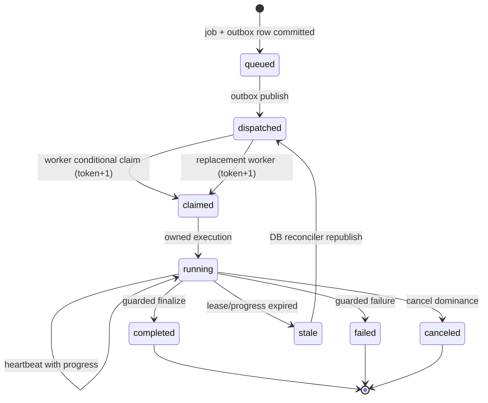

# Release 1 Final Architecture Approval

Status: **approval package only.** P0 has been executed. **P1 and every later
phase remain unauthorized.** No application source, schema, migration, API,
frontend, dependency, or deployment configuration was changed by this package.

Companion documents:

- [`RELEASE_1_FINAL_DECISION_REGISTER.md`](./RELEASE_1_FINAL_DECISION_REGISTER.md)
- [`RELEASE_1_CELERY_REDIS_DECISION.md`](./RELEASE_1_CELERY_REDIS_DECISION.md)
- [`RELEASE_1_P1_SCOPE_AND_MIGRATION.md`](./RELEASE_1_P1_SCOPE_AND_MIGRATION.md)
- [`RELEASE_1_PRODUCTION_EVIDENCE_PLAN.md`](./RELEASE_1_PRODUCTION_EVIDENCE_PLAN.md)
- [`RELEASE_1_P0_EXECUTION_REPORT.md`](./RELEASE_1_P0_EXECUTION_REPORT.md)
- [`RELEASE_1_P0_TEST_RESULTS.md`](./RELEASE_1_P0_TEST_RESULTS.md)
- [`RELEASE_1_P0_FAILURE_ANALYSIS.md`](./RELEASE_1_P0_FAILURE_ANALYSIS.md)
- [`RELEASE_1_P0_CONFIGURATION_FINDINGS.md`](./RELEASE_1_P0_CONFIGURATION_FINDINGS.md)
- [`RELEASE_1_P0_FINAL_RECOMMENDATIONS.md`](./RELEASE_1_P0_FINAL_RECOMMENDATIONS.md)
- [`RELEASE_1_CHECKPOINT_RECOVERY_CONTRACT.md`](./RELEASE_1_CHECKPOINT_RECOVERY_CONTRACT.md)
- [`RELEASE_1_SCHEDULE_WINDOW_CONTRACT.md`](./RELEASE_1_SCHEDULE_WINDOW_CONTRACT.md)
- [`LEASE_AND_FENCING.md`](./LEASE_AND_FENCING.md)
- [`ARTIFACT_PUBLICATION.md`](./ARTIFACT_PUBLICATION.md)
- [`OUTBOX_AND_DISPATCH.md`](./OUTBOX_AND_DISPATCH.md)

## 1. Evidence base

| Item | Result |
|---|---|
| P0 harness tests | 19 executed |
| Passed | 18 |
| Failed | 1 (`P0-13`, visibility redelivery) |
| Manual Redis AOF checks | 2 executed, 2 passed |
| Blocked | 1 area (real S3-compatible provider) |
| Production measurements | Not available |
| Business decisions | Not approved |

The single failed test is the load-bearing result:

- `P0-13`: with two solo Celery 5.4.0 workers already running, Redis 7
  visibility 5 s, and a 10 s task, **no redelivery occurred within 18 s**. The
  task stayed in `unacked_index`.
- `P0-13b`: starting a **new** worker restored the unacked task and produced a
  **duplicate start** while the original was still running.

Therefore broker visibility is a **backstop**, not a recovery clock. Recovery
must be driven from PostgreSQL lease state.

### 1.1 P0 findings incorporated

| Finding | Where recorded | Architectural consequence |
|---|---|---|
| P0-13 visibility did not redeliver with two active workers | P0 report/test results; D9 | DB lease-expiry re-dispatch is mandatory |
| P0-13b new worker restored unacked task and duplicated start | P0 report/failure analysis; D9 | Claim-before-execution and fencing are mandatory before scaling |
| Lease expiry does not terminate a process | D9 section 4; this document section 4 | Slot termination is a separate mechanism |
| D3 zero-committed checkpoint restarts | Checkpoint contract; P0-12 | No resume from `completed_chunks=0` |
| Checkpoint crash matrix passed after correction | P0-12 | Resume only on the strict validated matrix |
| Schedule ledger primitives passed | P0-09; D11 | Ledger design is viable; production integration still unproven |
| Attempt-scoped artifact isolation passed | P0-10; A1 | Attempt paths isolate bytes |
| Cleanup ownership model passed | P0-17; A2 | Protect active/published/rollup/checkpoint files |
| S3 stub passed basic object/pointer/cleanup logic | P0-11; A1 | **Not** real-provider verification |
| AOF key and queued message survived restart | P0-AOF-01/02 | AOF works in isolation; capacity/eviction unproven |
| Production timing/Redis/S3/consumers unmeasured | Evidence plan | Required before P2/production |

**Stub limitation:** the P0 S3 endpoint was a local HTTP stub. It does not prove
multipart upload, conditional writes, IAM/signature behavior, versioning/object
lock, or provider listing consistency. Those remain blocked until a real
S3-compatible staging test.

## 2. Final architecture

**PostgreSQL is the execution authority. Redis/Celery is transport only.**

| Concern | Authority | Transport / cache |
|---|---|---|
| Job existence and status | `jobs` row | Celery message |
| Ownership | `jobs.owner_id` | — |
| Fencing | `jobs.lease_token` | — |
| Lease expiry | `jobs.lease_expires_at` | — |
| Liveness | `jobs.progress_at`, `heartbeat_at` | — |
| Recovery decision | reconciler query on `jobs` | re-published task |
| Dispatch durability | `job_dispatch_outbox` | Redis publish |
| Schedule obligation | `schedule_windows` | beat trigger |
| Artifact publication | `jobs.*_path` guarded pointer | local/S3 bytes |
| S3 publication | `jobs.s3_published_attempt` | S3 objects |

Rules:

1. A Celery message is an **invitation to claim**, never authority to write.
2. Every worker write is guarded by `lease_token` and (where applicable)
   `owner_id`.
3. A zero-row guarded update is a **lost lease**; the worker aborts before any
   artifact, checkpoint, or S3 publication.
4. Lease renewal requires **observed progress**; a bare liveness ping does not
   extend the lease indefinitely.
5. Recovery is a database decision followed by a durable outbox publish.
6. Duplicate Celery messages are expected and safe because only one claim wins.

## 3. D9 lifecycle

### 3.1 States

`dispatched`, `claimed`, and `stale` are **derived phases** unless a persisted
column is explicitly approved. The persisted status vocabulary stays the
existing six values. See D1/D2 in the decision register.

### 3.2 Step contract

| # | Step | Owner | Durable write | Guard |
|---|---|---|---|---|
| 1 | Create job + outbox intent | API | `jobs` + `job_dispatch_outbox` in one transaction | unique `(job_id, task_name)` |
| 2 | Publish `run_job` | dispatcher | mark outbox `published` after publish | claim lock |
| 3 | Consume message | worker | none | message may be duplicate |
| 4 | Claim | worker | `status='running'`, `owner_id`, `lease_token+1`, `lease_expires_at`, `progress_at` | `status='queued'` or expired lease |
| 5 | Reject duplicate claim | worker | none | loser gets 0 rows and exits cleanly |
| 6 | Renew | worker | `heartbeat_at`, `lease_expires_at` | `owner_id` + `lease_token`; only after progress |
| 7 | Checkpoint | worker | `completed_chunks`, offsets, `progress_at` | same lease, monotonic chunk |
| 8 | Finalize | worker | terminal status, completion fields, artifact pointers | `owner_id` + `lease_token` |
| 9 | Detect stale | reconciler | event/metric; no terminal rewrite unless reaper path | expired lease or silent progress |
| 10 | Re-dispatch | reconciler | new/updated outbox intent | capped attempts + backoff |
| 11 | Replacement claim | worker | `lease_token+1` | normal claim predicate |
| 12 | Original write | stale worker | 0 rows | abort before side effects |

### 3.3 Original worker still running when replacement is dispatched

The reconciler does **not** kill the process. It only changes authority.

| Surface | Original worker behavior after replacement | Safety |
|---|---|---|
| Job claim / heartbeat | Guarded update returns 0 rows | No renewal |
| Checkpoint / progress | Guarded update returns 0 rows | No committed chunk |
| Terminal status | Guarded update returns 0 rows | Cannot overwrite winner |
| Artifact pointer | Guarded update returns 0 rows | Cannot publish path |
| Local artifact bytes | Continues writing its own attempt file | Attempt-scoped; orphan only |
| Distinct store | Continues writing its own attempt store | Attempt-scoped; orphan only |
| S3 upload | Publishes under its attempt token; pointer update 0 rows | Unreferenced objects only |
| Worker slot | **Still occupied until the task returns or is killed** | Not solved by fencing |
| Logs/metrics | Must log `lease_lost` and stop cooperatively | Required |

**Contract:** a stale worker must abort at the first zero-row guarded write and
must not continue to a terminal write "just to clean up." Any cleanup it does
must be attempt-scoped and safe to orphan.

### 3.4 Why claim-before-execution is mandatory

`P0-13b` shows that worker startup can restore an unacked message while the
original is alive. Without claim-before-execution, both processes would run the
job. With claim-before-execution:

- exactly one process wins the token;
- the loser exits without writing;
- a later replacement increments the token again;
- the oldest process is fenced by both newer tokens.

Fencing protects **data**. It does not protect **worker slots**.

## 4. Worker slot termination

Lease expiry does not terminate a process. If a worker hangs in a C-level or
network call, its DB row is recoverable but its slot is not.

| Mechanism | Frees slot | Data safety | Cost / risk | Status |
|---|---|---|---|---|
| DB lease + reconciler | No | High | Slot can stay occupied | **Required** |
| Cooperative cancellation check | Sometimes | High | Depends on loop checkpoints | Required in task loop |
| `task_soft_time_limit` | Sometimes | High if handler checkpoints | Signal delivery limits; handler needed | Candidate |
| `task_time_limit` (hard) | Yes (kills child) | Safe with checkpoint + fencing | Kills legitimate long work; resume cost | Candidate after measurement |
| Orchestrator watch + SIGKILL | Yes | Safe with checkpoint + fencing | External complexity; deployment coupling | Optional backstop |
| Kubernetes/Compose restart policy | Only on process exit | Safe | Does not detect a hung-but-alive process | Not sufficient |

Recommendation:

1. Implement claim/fence/reconciler in P2 and P6 (required).
2. Add a cooperative cancellation check at chunk boundaries (required in P2).
3. Add a **configurable** soft/hard attempt limit in P6/P9 **after** production
   runtime measurement. Do not hard-code 23 h/24 h in P1.
4. Treat an external watchdog as a deployment option, not a correctness
   requirement.

## 5. Runtime limit policy

The proposed 23 h soft / 24 h hard is **not approved**.

### 5.1 What must be measured

| Measurement | Why it sets the limit |
|---|---|
| p50/p95/p99/p999 total job duration | Baseline for any soft limit |
| Longest legitimate single chunk | Soft limit must exceed this |
| Longest legitimate silent stage (no committed progress) | Sets progress timeout and soft limit |
| Longest finalization / summary / rollup stage | Must not be killed mid-publish |
| Worker slot occupancy distribution and queue wait | Determines operational damage of a stuck slot |
| Recovery cost after a kill | Resume replay time and Last9 re-query cost |
| S3 upload duration for largest artifact | Affects finalization limit |

### 5.2 Options

| Option | Bounds slot | Recovers row | Kills healthy long job | Recommendation |
|---|---|---|---|---|
| 1. No runtime limit; DB reconciler only | No | Yes | Never | Not sufficient alone |
| 2. Soft limit just below hard; hard cap per attempt | Yes | Yes | Only above measured max | **Recommended after measurement** |
| 3. Bounded execution units (chunk-sized tasks) | Yes | Fast | No | Best long-term; larger refactor |
| 4. External watchdog only | Yes | Yes | On watchdog threshold | Backstop, not primary |

**Policy recommendation:** Option 2 with values derived from measurement;
retain Option 3 as the future design if slot pressure or recovery latency
becomes material.

Values that must remain **unapproved** until evidence exists:

- soft limit;
- hard limit;
- visibility timeout as a production number;
- progress timeout;
- lease TTL;
- heartbeat interval;
- reaper grace;
- Docker stop grace.

## 6. Redis configuration

Evaluate independently; do not bundle into one "Redis change."

| Setting | Current | Recommendation | Evidence status |
|---|---|---|---|
| `visibility_timeout` | unset (3600 default) | Set explicitly; treat as backstop only | P0 showed it is not a recovery clock |
| Broker AOF | on | Keep; capacity analysis first | P0 AOF-01/02 passed in isolated stack |
| `maxmemory-policy` | not set | `noeviction` + headroom, or measured policy | **Requires capacity data** |
| `result_expires` | 3600 | `ignore_result` for `run_job` or > max runtime | Config evidence, not a P0 runtime test |
| `task_acks_late` | True | Keep | P0 observed unacked behavior |
| `task_reject_on_worker_lost` | True | Keep | P0-14 passed |
| `worker_prefetch_multiplier` | 1 | Keep | Config evidence |
| Hard/soft limits | unset | Configurable after measurement | Business decision |
| Eviction of unacked/outbox keys | unknown | Must not evict broker keys | **Requires production evidence** |

**Do not** set visibility to 24 h as a substitute for recovery. That increases
unacked retention and still does not guarantee redelivery (`P0-13`).

## 7. Decision summary

| ID | Decision | Recommended | Approval | Phase |
|---|---|---|---|---|
| D1/D2 | Cancel/pause semantics | Request timestamps + derived phase; owner/token is truth | Required | P1/P2/P3 |
| D3 | Checkpoint recovery | Strict matrix; `completed_chunks=0` restarts | Required | P1/P4 |
| D8 | Lease/progress config | 600/60/60/3600/60 provisional; measure | Required | P2/P6 |
| D9 | Celery/Redis/reconciler | DB-authoritative + mandatory reconciler; limits after measurement | Required | P2/P6/P9 |
| D10 | Completion integrity | Minimum fields + partial UI; no seventh status | Required | P1/P2/P3 |
| D11 | Schedule ledger | Full calendar+interval ledger recommended | **Business** | P1/P7 |
| D13 | DB constraints | Audit then CHECKs | Required | P9 |
| A1 | Artifact paths | Attempt-scoped local/S3 + pointer publication | Required | P1/P4/P8 |
| A2 | Cleanup ownership | Protect active/published/rollup/checkpoint; orphan scan | Required | P4/P7/P8 |
| P0 | Test foundation | Complete with 1 failed, 1 blocked | Informational | done |

Detailed fields are in
[`RELEASE_1_FINAL_DECISION_REGISTER.md`](./RELEASE_1_FINAL_DECISION_REGISTER.md).

## 8. P1 boundary in one page

P1 is **additive schema and state primitives only**.

Adds:

- `jobs` ownership/fencing/progress/completion columns;
- `jobs` artifact/store/spec/checkpoint pointer columns;
- `job_dispatch_outbox` table;
- `schedule_windows` table plus `jobs.schedule_window_id`/`attempt_no`;
- `jobs` S3 attempt columns.

Does not:

- read or enforce the new columns in API/worker behavior;
- enable fencing, re-dispatch, outbox publishing, schedule scanning, or S3
  attempt publication;
- change any API response, worker task, frontend, dependency, or deployment
  setting;
- add CHECK constraints (deferred to P9);
- run migrations against production.

Exact DDL, compatibility, and rollback:
[`RELEASE_1_P1_SCOPE_AND_MIGRATION.md`](./RELEASE_1_P1_SCOPE_AND_MIGRATION.md).

## 9. Production evidence gates

| Gate | Evidence | Owner decision |
|---|---|---|
| Before P1 | Additive migrations apply/downgrade cleanly on a Postgres 16 copy; no read/write behavior change; rollback rehearsal | P1 authorization |
| Before P2 | Real S3 provider (or accepted staging equivalent); Postgres claim/fence under production-like concurrency; runtime distribution baseline | D3/D8/D9 |
| Before production | Runtime limits; progress timeout; Redis capacity/AOF/eviction; slot occupancy; stop grace; canonical-path consumers; schedule/report/rollup integration | D9/D11/A1/A2 |

Detail: [`RELEASE_1_PRODUCTION_EVIDENCE_PLAN.md`](./RELEASE_1_PRODUCTION_EVIDENCE_PLAN.md).

## 10. Final verdict

### Q1. Is the architecture ready for P1?

**Yes, for a strictly additive P1 only**, provided the inert schema shape
(D1/D2, D3, D8, D10, A1 columns; D11 tables if the ledger approach is retained)
is approved and the P1 migration evidence gate passes.

If D11 REDUCED is chosen, exclude both `0035` and `0036`; the P1 graph becomes
`0031 -> 0032 -> 0032b -> 0033 -> 0034`. Add the ledger/S3 columns later when
separately approved.

The architecture is **not** ready for P2 behavior until real-provider S3
evidence and the runtime/lease measurements exist.

### Q2. Which decisions still need approval?

Mandatory:

1. **D9**: accept PostgreSQL-authoritative recovery and make the DB
   lease-expiry re-dispatch reconciler a Release 1 requirement.
2. **D9 runtime**: approve or explicitly defer the soft/hard limit policy.
3. **D8**: accept provisional lease/progress values as unapproved defaults.
4. **D3**: accept the strict checkpoint matrix including zero-commit restart.
5. **D13**: accept audit-then-CHECK timing.

Business:

6. **D11**: full calendar+interval ledger vs reduced scope.
7. **D9 production Redis**: capacity/persistence/eviction policy.
8. **D10**: partial-result UI/product behavior.

### Q3. What are the exact P1 boundaries?

Only the additive migrations `0032`–`0036` for D11 FULL. For D11 REDUCED, only
`0032`, `0032b`, `0033`, `0034`; `0035` and `0036` are excluded. No runtime
read/enforcement, no CHECK constraints, no behavior change, no migrations on
production. See the P1 document.

### Q4. Which changes must remain disabled until P2?

Everything that reads or acts on the new state stays disabled until its phase:

- Claim/fencing enforcement (P2).
- Heartbeat/progress renewal (P2).
- Stale-worker write rejection (P2).
- Lease-expiry reconciler (P2/P6).
- Outbox publishing/dispatch (P6).
- Schedule window scanning and job creation (P7).
- Attempt-scoped artifact path selection and pointer publication (P4).
- S3 attempt publication/fencing (P8).
- Cancel/pause request semantics and partial-result derivation (P2/P3).

P1 itself enables none of these. "Until P2" above is the earliest gate; P6/P7/P8
items stay disabled until their own phase.

### Q5. What can safely be deferred?

- Full ledger `window_key` semantics and scheduler/report/rollup integration
  (D11).
- CHECK constraints (P9).
- Bounded execution units.
- External watchdog.
- Hard/soft limits until measured.
- Redis `noeviction`/capacity tuning until measured.
- S3 multipart/conditional/versioning refinements until provider evidence.
- Retry lineage/backoff hardening (P9).

### Q6. What must be proven before production rollout?

1. Real S3-compatible provider behavior, or an explicitly approved equivalent.
2. Production runtime distribution, longest chunk, longest silent stage,
   finalization duration.
3. Postgres claim/fence/lease/reconciler behavior under production-like
   concurrency and isolation.
4. Redis recovery, AOF, eviction, memory headroom, and unacked growth.
5. Worker slot occupancy and the operational cost of a stuck slot.
6. Canonical-path external consumers are migrated or proven unaffected.
7. Schedule/report/rollup integration selects one winner and does not
   double-count.
8. Stop-grace behavior for long tasks and a rehearsed rollback.

## 11. Approval record

| Item | State |
|---|---|
| Architecture direction (Postgres authority) | **Recommended; awaiting approval** |
| P1 authorization | **Not granted** |
| P2+ authorization | **Not granted** |
| D9 runtime limits | **Not approved** |
| D11 scope | **Not approved** |
| Production Redis changes | **Not approved** |
| Production migration | **Not approved** |

## 12. Stop condition

This package stops at documentation. No P1 code, schema, migration, API,
frontend, dependency, or deployment change has been made. P1 must not begin
until the user explicitly authorizes it.
