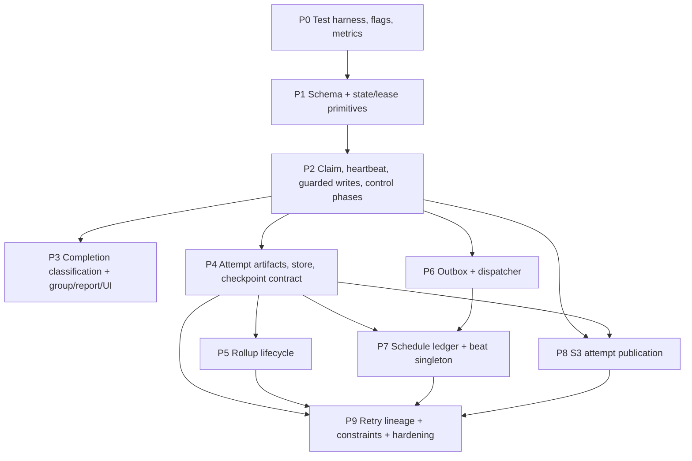

# Release 1 Implementation Blueprint

Status: implementation plan only. No code has been written. No source, schema,
migration, API, dependency, or deployment file was changed.

> **P0 has now been executed.** Results: 19 executed, 18 passed, 1 failed
> (P0-13 visibility), 1 real-S3 area blocked. P1 is **not** authorized.
> See [`RELEASE_1_P0_EXECUTION_REPORT.md`](./RELEASE_1_P0_EXECUTION_REPORT.md)
> and [`RELEASE_1_P0_FINAL_RECOMMENDATIONS.md`](./RELEASE_1_P0_FINAL_RECOMMENDATIONS.md).
> D9 must be revised to require DB lease-expiry re-dispatch before P1.

Inputs: [`RELEASE_1_READINESS_REVIEW.md`](./RELEASE_1_READINESS_REVIEW.md),
[`RELEASE_1_DESIGN.md`](./RELEASE_1_DESIGN.md),
[`RELEASE_1_MIGRATION_PLAN.md`](./RELEASE_1_MIGRATION_PLAN.md),
[`RELEASE_1_ARCHITECTURE_DECISIONS.md`](./RELEASE_1_ARCHITECTURE_DECISIONS.md).

## 1. Principles for slicing

- Each phase is a small, reviewable pull request or a short PR stack.
- Schema changes are additive first; behavior flags are off until compatibility
  conditions are met.
- No phase depends on a later phase.
- Every phase has a rollback that does not require dropping data.
- Concurrency tests with Postgres/Redis are written before enforcement.
- A phase is not "done" until its failure-mode tests fail on the old code and
  pass on the new code.

## 2. Dependency graph

## 3. Phase 0 - Test harness, flags, and observability

**Objective.** Make the current system measurable and give every later phase a
safe test bed.

**Functionality included.**

- Postgres test database profile (`pg`) and Redis/Celery integration profile
  (`broker`); SQLite remains the fast unit profile.
- Fixtures for two workers, blocked claims, lease expiry, fake S3 client,
  fake Redis, fault injection at fsync/DB commit, and a controllable clock.
- Structured transition logs and metric names; no behavior change.
- Feature flags with conservative defaults (`JOB_LEASE_MODE=off`,
  `ARTIFACT_ATTEMPT_PATHS=false`, `DISPATCH_MODE=direct`,
  `SCHEDULE_WINDOWS_ENABLED=false`, `S3_ATTEMPT_FENCING=false`).
- Baseline dashboards for current claim/queue/schedule behavior.

**Files/modules.** `api/tests/conftest.py`, `worker/tests/conftest.py`, new
`api/tests/integration/`, `worker/tests/integration/`, `api/app/config.py`,
`worker/app/config.py`, new metrics/log helper, `docs/RELEASE_1_*`.

**Database changes.** None.

**API changes.** None.

**Frontend changes.** None.

**Dependencies.** None.

**Failure scenarios addressed.** Test observability; no production behavior.

**Unit tests.** Flags default; log fields; metric increments.

**Integration tests.** Postgres connection/schema; Redis ping; fake S3 upload.

**Concurrency tests.** Two-session claim harness; barrier; row-lock timeout.

**Regression tests.** Existing SQLite suite remains green and fast.

**Deployment requirements.** No production deploy; CI profiles only.

**Rollback.** Remove the harness/flags.

**Acceptance criteria.** The concurrency harness can fail on the current
unconditional write and pass only after fencing. No production behavior
changes.

## 4. Phase 1 - Schema and shared primitives

**Objective.** Add the additive schema and the shared state constants without
changing runtime behavior.

The authoritative P1 boundary is
[`RELEASE_1_P1_SCOPE_AND_MIGRATION.md`](./RELEASE_1_P1_SCOPE_AND_MIGRATION.md).
That document overrides this summary.

**Functionality included.**

- Migration `0032_job_ownership_and_completion.py`: owner/lease/heartbeat/
  progress/cancel/pause/completion/gap/retry lineage columns only; no indexes.
- Migration `0032b_jobs_lease_indexes.py`: partial concurrent
  `ix_jobs_lease`, `ix_jobs_owner`, `ix_jobs_progress`; no `ix_jobs_retry_of`.
- Migration `0033_job_artifact_paths.py`: `store_path`, `spec_fingerprint`,
  `checkpoint_version`.
- Migration `0034_job_dispatch_outbox.py`: empty outbox table + new-table indexes.
- Migration `0035_schedule_windows.py`: empty window table + new-table indexes,
  `jobs.schedule_window_id`, `jobs.attempt_no`; no jobs indexes.
- Migration `0036_s3_attempt_publication.py`: S3 attempt columns only; no index.
- ORM/table-mirror declarations for the new columns/tables.
- Shared `JobStatus`/`COMPLETION_STATE`/transition constants in API and worker
  (mirrored, with a contract test).
- No transition behavior change. No column is read by runtime code.

`0035b` (schedule jobs indexes) and `0036b` (S3 index) are deferred to P7/P8
and are not part of P1. `ix_jobs_retry_of`, `ix_jobs_schedule_window_id`, and
`ix_jobs_s3_uploading` are not created in P1.

**Files/modules.** `api/app/models.py`, `worker/app/db.py`, new
`api/app/job_state.py`, new `worker/app/job_state.py`, migrations, state contract
tests. No router, task, frontend, dependency, or deployment change.

**Database changes.** Additive columns/indexes/tables only. No CHECK constraints
(0037 is P9). No backfill: P1 leaves existing rows at column defaults; P2's
reconciler must treat `progress_at IS NULL` on legacy rows as
`COALESCE(updated_at, started_at)` until the first progress write.

**API changes.** None. Do not declare or serialize new response fields in P1.

**Frontend changes.** None.

**Dependencies.** P0.

**Failure scenarios addressed.** Schema/worker mismatch; vocabulary drift;
unknown legacy completion.

**Unit tests.** Model/mirror equality; default values; state constant contract.

**Integration tests.** Apply `0032`, `0032b`, `0033`, `0034`, `0035`, `0036`
individually on a populated Postgres 16 copy; downgrade in reverse order;
re-upgrade; SQLite `create_all`.

**Concurrency tests.** None (schema only).

**Regression tests.** Existing API/worker suites pass with old behavior.

**Deployment requirements.** Migrate before code; old code ignores fields; no
P2 behavior in the same deployment.

**Rollback.** Downgrade the additive migrations while no P2 state exists; after
P2, roll back P2 first. See the P1 document.

**Acceptance criteria.** `alembic current` at 0036; old API/worker still create
and complete jobs; no field is read by old code; new tables empty.

## 5. Phase 2 - Claim, fencing, heartbeat, and control phases

**Objective.** One owner per job; every worker write is guarded; cancel is
dominant; pause/resume cannot create two writers.

**Functionality included.**

- `worker/app/lease.py`: `Lease`, `acquire`, `renew`, `update_owned`,
  `finalize_owned`, `add_event_owned`, `LeaseLost`.
- Claim/reclaim conditional update with token, owner, expiry, progress.
- Heartbeat thread with in-process progress tracking and `progress_at`.
- Guarded progress/checkpoint/terminal writes; 0 rows -> abort.
- `run_job` claims before validation; `_mark_failed` is lease-aware.
- API pause/resume/cancel conditional updates; request timestamps; derived
  `phase`/`is_finalizing`; download gating.
- Resume clears owner and bumps token; cancel dominance.
- Rollup still on the old path until P5.

**Files/modules.** `worker/app/lease.py`, `worker/app/db.py`,
`worker/app/runner.py`, `worker/app/tasks.py`, `worker/app/scheduler.py`,
`worker/app/config.py`, `api/app/routers/jobs.py`, `groups.py`,
`api/app/schemas.py`, `api/app/config.py`.

**Database changes.** None beyond P1.

**API changes.** Add `phase`, `is_finalizing`; same status codes; conditional
409s; download URL withheld while finalizing.

**Frontend changes.** Minimal: consume `phase`/`is_finalizing` if the field is
present; no new workflow.

**Dependencies.** P0, P1.

**Failure scenarios addressed.** Concurrent claims, stale writes, reclaim,
cancel/complete race, pause/resume race, hung main loop, DB outage.

**Unit tests.** Claim SQL shape; token increment; progress clock; 0-row
`LeaseLost`; cancel dominance; pause finalize; terminal re-read.

**Integration tests.** Postgres claim/fence; heartbeat renew/stop; DB outage;
reaper; `_mark_failed` conditions.

**Concurrency tests.** Two claims; old token after reclaim; cancel/complete
orderings; pause/resume; reaper vs late write.

**Regression tests.** Existing transitions and API status responses.

**Deployment requirements.** Migrate; deploy worker in `observe`, then API with
cancel-fence off, then enforce after all workers are new. See
`RELEASE_1_DEPLOYMENT.md`.

**Rollback.** `JOB_LEASE_MODE=off`, `JOB_CANCEL_FENCE=false`,
`JOB_RECLAIM_MODE=event`; revert code; leave columns.

**Acceptance criteria.** One claim wins; stale token 0 rows; cancel never
completed; resume fences old worker; heartbeat cannot renew without progress;
reaper uses lease/progress.

## 6. Phase 3 - Minimum completion integrity and UI/derivation

**Objective.** Make known gaps programmatically visible and prevent a partial
result from appearing as a clean success.

**Functionality included.**

- Set `completion_state`/`gap_count`/`gap_reason` in every terminal path:
  clean, skipped batches, rollup skip (after P5), BQ drops, cancel, preview,
  failure, reaper.
- Group: any child partial -> `partial`.
- Report: partial propagation; successful attempt/window source (with P7).
- `JobOut`: fields; `Job` TS type; job list/detail partial badge and gap reason.
- Shared derivation helper/contract test.

**Files/modules.** `worker/app/runner.py`, `worker/app/tasks.py`,
`worker/app/scheduler.py`, `api/app/routers/groups.py`,
`api/app/routers/reports.py`, `api/app/schemas.py`, `web/lib/api.ts`,
`web/app/jobs/page.tsx`, `web/app/jobs/[id]/page.tsx`,
`web/app/groups/[id]/page.tsx`, `web/app/reports/page.tsx`.

**Database changes.** Fields already in P1; no new migration.

**API changes.** Additive completion fields; group/report partial; no status
vocabulary change.

**Frontend changes.** Partial badge, gap reason, do not label `completed` as
clean when partial.

**Dependencies.** P2 (terminal guarded writes).

**Failure scenarios addressed.** Skipped batches reported clean, canceled as
success, failed before coverage, legacy unknown.

**Unit tests.** Completion classifier; group/report helper; legacy unknown.

**Integration tests.** API serialization; UI type contract; partial group/report.

**Concurrency tests.** Terminal write sets completion once; no lost update.

**Regression tests.** Existing status maps and tabs still work.

**Deployment requirements.** Deploy after P2; old clients ignore new fields.

**Rollback.** Stop reading fields; leave data. UI can hide partial badge.

**Acceptance criteria.** No known-gap job is displayed or aggregated as clean;
group/report/job UI agree.

## 7. Phase 4 - Attempt-scoped artifacts, store, and checkpoint contract

**Objective.** No two attempts share local bytes; resume validates identity,
artifact, and store; publication is a DB pointer.

**Functionality included.**

- Attempt-scoped output/summary/counts/unmatched/store paths.
- Checkpoint identity: version, source/lineage, spec fingerprint, artifact/
  store paths, offsets, store marker.
- Resume validation matrix (D3): resume only clean/same lineage/same config/
  valid artifact+store; otherwise restart; fail manual on unknown schema/path/
  IO.
- Store merge preserving `last_chunk_committed`.
- Update `runner.output_path`/summary/counts/unmatched/store builders.
- Update `rollup._concat_raw`, `rollup.find_source_jobs`,
  `scheduler.cleanup_exports`, `customers.py` cleanup.
- Publish pointers under lease; stale attempt cannot overwrite.

**Files/modules.** `worker/app/runner.py`, `worker/app/rollup.py`,
`worker/app/last9/checkpoint.py`, `worker/app/last9/extract.py`,
`worker/app/last9/distinct_store.py`, `worker/app/db.py`,
`worker/app/scheduler.py`, `api/app/routers/customers.py`,
`api/app/routers/jobs.py`, `api/app/models.py`, migration `0033`.

**Database changes.** `store_path`, `spec_fingerprint`, `checkpoint_version`;
no path column for attempt files beyond the pointers. `retry_of` is in `0032`,
not `0033`.

**API changes.** Downloads/deletes use recorded paths; no filename change.

**Frontend changes.** None, unless cleanup/empty states need copy.

**Dependencies.** P2, P3.

**Failure scenarios addressed.** Concurrent local writers, torn CSV/store,
missing artifact, checkpoint newer/older than artifact, missing chunks,
unmatched artifact, orphan cleanup, canonical-path assumptions.

**Unit tests.** Path builder; checkpoint validation matrix; store merge marker;
file offset/truncation; zip rejection; skip-raw-output.

**Integration tests.** Pause/resume/cancel, crash at each checkpoint step,
store-behind/ahead, missing/corrupt artifact, cleanup.

**Concurrency tests.** Two attempts writing different paths; stale pointer
update 0 rows; customer cleanup while an attempt is active.

**Regression tests.** Download names, delete files, rollup concat, retention.

**Deployment requirements.** Migrate 0033; deploy worker with
`ARTIFACT_ATTEMPT_PATHS=true`; deploy API cleanup changes; canary.

**Rollback.** `ARTIFACT_ATTEMPT_PATHS=false`; old code reads
`output_file_path`; store rollback needs a copy/link shim for `store_path`.

**Acceptance criteria.** No stale byte overwrite; resume never produces a
tail-only file; cleanup never deletes a referenced path; canonical assumptions
removed.

## 8. Phase 5 - Rollup lifecycle

**Objective.** Rollups use the same claim/lease/cancel/finalization and a
deterministic source winner.

**Functionality included.**

- `run_rollup(job_id, lease)`; no unconditional `running`.
- Guarded progress; poll pause/cancel between sources; cancel/failed finalize.
- Source selection uses the successful attempt/window (with P7), `store_path`
  fallback.
- Partial source -> `completion_state=partial`, gap count/reason.
- Attempt-scoped destination store/output; publish under lease.
- Retry of a rollup restarts the merge.

**Files/modules.** `worker/app/rollup.py`, `worker/app/tasks.py`,
`worker/app/scheduler.py`, `worker/app/db.py`, `api/app/routers/jobs.py`.

**Database changes.** None beyond P1/P4.

**API changes.** None; fields additive.

**Frontend changes.** None.

**Dependencies.** P2, P4.

**Failure scenarios addressed.** Duplicate rollup, cancel overlap, stale merge,
missing source, double-count winner, canonical concat.

**Unit tests.** Source filter, partial classification, cancel, rollup retry.

**Integration tests.** Duplicate dispatch, cancel mid-merge, missing store,
source winner.

**Concurrency tests.** Two rollups; old token after reclaim.

**Regression tests.** Existing rollup API/values.

**Deployment requirements.** Deploy after P4; canary month window.

**Rollback.** Revert rollup code only after cancel-fence is off; keep P4 paths.

**Acceptance criteria.** One writer; canceled stays canceled; partial sources
visible; no canonical concat.

## 9. Phase 6 - Transactional outbox and dispatcher

**Objective.** Job insert and dispatch intent commit together; broker outages
do not orphan jobs; duplicates execute once.

**Functionality included.**

- `job_dispatch_outbox` table/migration `0034`; unique `(job_id,task_name)`.
- Insert outbox rows with jobs in create/batch/group/retry/rollup/schedule.
- Inline fast path after commit; dispatcher with lock columns/SKIP LOCKED;
  retry/backoff/failed state; reconciliation for stale queued jobs.
- Dispatch S3 via the same outbox later.
- Metrics/alerts.

**Files/modules.** `api/app/routers/jobs.py`, `groups.py`,
`api/app/tasks_client.py`, new `api/app/outbox.py`,
`worker/app/scheduler.py`/new `worker/app/dispatcher.py`,
`worker/app/celery_app.py`, configs, migration.

**Database changes.** New table/index; backfill queued jobs.

**API changes.** Create returns 201 even on inline publish failure; additive
dispatch state if exposed.

**Frontend changes.** None; queued jobs remain visible.

**Dependencies.** P2 (duplicate safe); can run in parallel with P3/P4.

**Failure scenarios addressed.** Broker down, crash after publish before mark,
batch partial, queued orphan, duplicate publish.

**Unit tests.** Outbox insert, backoff, mark/publish crash, reconciliation.

**Integration tests.** Broker down; duplicate publish; batch rollback; stale
published reset.

**Concurrency tests.** Two dispatchers; duplicate claim; two creates.

**Regression tests.** Existing create/batch/group/retry/rollup dispatch.

**Deployment requirements.** Table/backfill; dispatcher with `direct`, then API
`dual`, then `outbox`; all API instances new before outbox-only.

**Rollback.** `DISPATCH_MODE=direct`; keep table; drain pending.

**Acceptance criteria.** Every committed job has a durable intent; duplicate
message = one execution; no create 500 after commit.

## 10. Phase 7 - Schedule ledger, recovery, and beat singleton

**Objective.** Every owed window is tracked; failed/missing/duplicate windows
recover; one beat scans.

**Functionality included.**

- `schedule_windows` migration `0035`: `window_key`, `scheduled_for`,
  `config_snapshot`, status/completion, attempts/backoff/current_job.
- `jobs.schedule_window_id`/`attempt_no`; jobs unique/active indexes are
  deferred to `0035b`/P7, not P1.
- Scan computes due slots (`day:`/`slot:`), upserts ledger, creates job+outbox,
  updates `last_run_at` as cursor.
- Dispatcher/worker terminal updates window in the same transaction.
- Failed/missing retry; partial completed + manual only; delete policy.
- Reports/rollups use successful attempt/window start.
- Dedicated beat + scan lock; stop old `-B`.

**Files/modules.** `worker/app/scheduler.py`, `worker/app/celery_app.py`,
`api/app/models.py`, `api/app/routers/schedules.py`,
`api/app/routers/reports.py`, `api/app/routers/jobs.py` (rollup source),
`worker/app/rollup.py`, migration, `RUNBOOK.md`.

**Database changes.** New table/indexes; jobs fields; seed recent legacy
windows.

**API changes.** Reports/schedules may expose window status; additive.

**Frontend changes.** Reports schedule/window status; ensure partial/missed
copy.

**Dependencies.** P4 (config/artifacts), P6 (outbox).

**Failure scenarios addressed.** Duplicate scans, failed/missing windows,
dispatch failure, backfill, schedule edit/delete, interval identity, winner
selection.

**Unit tests.** Window key generation; due slots; retry/backoff; delete policy;
partial.

**Integration tests.** Two scans; crash at each window stage; failed retry;
missing; backfill; winner; reports/rollup.

**Concurrency tests.** Two beats; two dispatchers; old beat stopped gate.

**Regression tests.** Existing schedules/reports; legacy jobs fallback.

**Deployment requirements.** Migrate; dedicated beat; scan lock; seed ledger;
`SCHEDULE_WINDOWS_ENABLED=true` only after old beat stopped.

**Rollback.** `SCHEDULE_WINDOWS_ENABLED=false`; keep table; legacy path; one
beat.

**Acceptance criteria.** One window/one active job; no lost or duplicate
successful extraction; partial visible; schedule changes/deletes deterministic.

## 11. Phase 8 - S3 attempt publication

**Objective.** Concurrent S3 uploads cannot overwrite; DB pointer identifies
the winning attempt; cleanup is safe.

**Functionality included.**

- `s3_attempt_token`, `s3_uploading_at`, `s3_published_attempt`,
  `s3_manifest_uri` migration `0036`.
- Attempt claim (post-completion recommended), unique prefix, manifest.
- Publish DB pointer only on full success; partial/error state; stale attempt
  cannot publish.
- Retry endpoint/outbox; cleanup unpublished prefixes; never delete published.
- UI derived state (pending/uploading/partial/published/failed/legacy).

**Files/modules.** `worker/app/s3.py`, `tasks.py`, `runner.py`,
`api/app/routers/jobs.py`, `api/app/models.py`, `api/app/schemas.py`,
`worker/app/scheduler.py`, `web/app/jobs/[id]/page.tsx`, migration.

**Database changes.** Four S3 fields; no new table.

**API changes.** Additive `s3_state`/manifest fields; retry 409 when locked.

**Frontend changes.** S3 badge uses derived state; published-with-error copy.

**Dependencies.** P2/P4 (local paths); P6 optional for durable retry.

**Failure scenarios addressed.** Concurrent retries, DB publish failure,
partial success, orphan cleanup, stale worker.

**Unit tests.** Attempt claim, key builder, manifest, publish fence, partial.

**Integration tests.** Two retries; stale publish; S3 failure; cleanup.

**Concurrency tests.** Two attempt claims; old token publication 0 rows.

**Regression tests.** Existing S3 profile/retry endpoints.

**Deployment requirements.** Migrate; `S3_ATTEMPT_FENCING=true`; canary upload.

**Rollback.** `S3_ATTEMPT_FENCING=false`; old `s3_uri` reads; defer cleanup.

**Acceptance criteria.** One published attempt; no stale overwrite; cleanup
never deletes winner.

## 12. Phase 9 - Retry lineage, constraints, hardening

**Objective.** Retry behavior matches the message and the schema is protected.

**Functionality included.**

- `retry_of`/lineage; resume validation from P4; group retry preserves lineage;
  single retry copies `group_id` or explicit group retry.
- Reaper message/UI matches `RETRY_MODE`.
- `0037_status_constraints.py` after audits.
- Orphan cleanup, status/completion/schedule checks, chaos/soak, runbooks.

**Files/modules.** `api/app/routers/jobs.py`, `groups.py`,
`worker/app/runner.py`, `scheduler.py`, `web` retry copy, migration, docs.

**Database changes.** CHECKs; optional indexes.

**API changes.** Additive retry lineage; behavior gated.

**Frontend changes.** Retry copy matches mode.

**Dependencies.** P4/P5/P7/P8.

**Failure scenarios addressed.** Tail-only retry, group detachment, invalid
status/completion, cleanup/rollback.

**Unit tests.** Retry matrix; lineage; CHECK validation.

**Integration tests.** Retry valid/invalid checkpoint; group retry; migration
audit; cleanup.

**Concurrency tests.** Retry vs cancel; reaper vs retry.

**Regression tests.** Full suite; API compatibility.

**Deployment requirements.** Audit statuses/duplicates; apply CHECKs; run
rollback rehearsal.

**Rollback.** Drop CHECKs; `RETRY_MODE=restart`; keep columns.

**Acceptance criteria.** Retry never publishes a tail-only file; constraints
match six statuses/completion; cleanup/rollback verified.

## 13. What must remain disabled

| Feature | Disabled until |
|---|---|
| `JOB_LEASE_MODE=enforce` | All workers are new; old running jobs drained. |
| `JOB_CANCEL_FENCE=true` | All workers are new. |
| `JOB_RECLAIM_MODE=lease` | Old running jobs drained. |
| `ARTIFACT_ATTEMPT_PATHS=true` | P4 tests pass; cleanup/rollup/customers updated. |
| `DISPATCH_MODE=outbox` | Dispatcher verified; all API instances dual-writing. |
| `SCHEDULE_WINDOWS_ENABLED=true` | Old `-B` stopped; ledger seeded; dedicated beat. |
| `S3_ATTEMPT_FENCING=true` | P8 tests pass; cleanup safe. |
| `RETRY_MODE=resume` | P4 validation tests pass. |
| CHECK constraints | Status/completion/schedule audits clean. |
