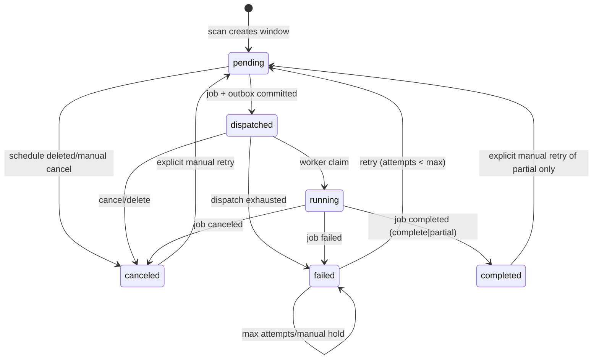

# Release 1 Schedule Window Contract

Status: specification only. Not implemented.

## 1. Purpose

Define a durable per-window obligation for calendar-day and interval schedules,
independent of the job lifecycle, so that due, missing, failed and duplicate
windows are recoverable.

## 2. Authority

| Model | Owns |
|---|---|
| `schedules` | Configuration, cadence, enabled/disabled, source/filter/format, alert recipients. |
| `schedule_windows` | One obligation/slot: identity, due time, snapshot, status, attempts, winner, completion. |
| `jobs` | One execution attempt: lease, progress, artifacts, completion state. |
| `job_dispatch_outbox` | Durable publish intent for a window's job. |
| `last_run_at` | Scan/dispatch cursor only; **not success**. |

The ledger does not replace job history. `schedule_windows.current_job_id`
points to the latest attempt; old attempts remain for audit.

## 3. Window identity

| Field | Type | Purpose |
|---|---|---|
| `id` | bigserial | Internal key. |
| `schedule_id` | integer | Owner. |
| `window_key` | varchar(80) | Stable identity. Calendar: `day:YYYY-MM-DD`; interval: `slot:<epoch>`. |
| `scheduled_for` | timestamptz | Due time for UI/backoff. |
| `start_epoch`, `end_epoch` | bigint | Actual extraction window. |
| `schedule_version` | bigint | Snapshot of schedule config version. |
| `config_snapshot` | jsonb/JSON | Source, filter, format, chunk/batch, S3, aggregation at creation. |
| `status` | varchar(16) | `pending`, `dispatched`, `running`, `completed`, `failed`, `canceled`. |
| `completion_state` | varchar(16) | `unknown`, `complete`, `partial` for the winning attempt. |
| `attempts` | integer | Number of job attempts created. |
| `max_attempts` | integer | Retry cap (default 3). |
| `current_job_id` | integer | Latest attempt. |
| `next_attempt_at` | timestamptz | Backoff/manual retry eligibility. |
| `last_error` | text | Dispatch/execution failure. |
| `created_at`, `updated_at` | timestamptz | Audit. |
| `completed_at`, `canceled_at` | timestamptz | Audit. |

Uniqueness:

```sql
UNIQUE (schedule_id, window_key)
```

One active job per window:

```sql
CREATE UNIQUE INDEX uq_jobs_schedule_active
  ON jobs(schedule_window_id)
  WHERE schedule_window_id IS NOT NULL
    AND status IN ('queued','running','paused');
```

Attempt uniqueness:

```sql
CREATE UNIQUE INDEX uq_jobs_schedule_attempt
  ON jobs(schedule_window_id, attempt_no)
  WHERE schedule_window_id IS NOT NULL;
```

## 4. Calendar vs interval identity

### Calendar-day

- `window_key = 'day:YYYY-MM-DD'` in **UTC**.
- `scheduled_for` = end of that UTC day (or the next scan tick after it).
- `start_epoch` = UTC midnight; `end_epoch` = next UTC midnight.
- DST is irrelevant because the boundary is UTC. The model comment mentioning
  IST is documentation drift; runtime is UTC.
- Backfill: one window per completed UTC day, oldest first, capped at 14.

### Interval

- `window_key = 'slot:<slot_epoch>'` where `slot_epoch` is a fixed dispatch slot
  (e.g., `floor(now / interval_seconds) * interval_seconds`).
- `scheduled_for` = slot epoch.
- `start_epoch = slot_epoch - lookback_seconds`; `end_epoch = slot_epoch`.
- Actual windows may overlap by design (rolling lookback). Overlap is not a
  duplicate slot.
- If the interval changes, future slots use the new interval; pending windows
  keep their snapshot and `window_key`. A schedule edit does not rewrite
  existing windows.

## 5. Lifecycle



### Transition rules

| From | To | Trigger | Guard | Side effects |
|---|---|---|---|---|
| - | pending | Scan due slot | `INSERT ... ON CONFLICT(schedule_id,window_key) DO NOTHING` | snapshot, scheduled_for |
| pending | dispatched | Dispatcher | due, attempts < max, no active job | insert job + outbox, `current_job_id`, `attempt_no`, attempts+1 |
| pending | canceled | Delete/cancel | no active job | canceled_at |
| dispatched | running | Worker claim | job lease acquired | status running; same transaction as claim |
| dispatched | failed | Dispatch exhausted | outbox failed/no job | last_error, next_attempt_at |
| running | completed | Job terminal completed | job terminal + artifact finalized | completion_state copied; completed_at |
| running | failed | Job terminal failed | terminal | last_error; next_attempt_at |
| running | canceled | Job terminal canceled | terminal | canceled_at |
| failed | pending | Retry scan/manual | attempts < max, due | next_attempt_at, last_error cleared |
| completed | pending | Manual partial retry | completion_state=partial, explicit | new attempt; old job history retained |
| canceled | pending | Manual retry | explicit | new attempt |

### Partial windows

- A partial job sets `status='completed'`, `completion_state='partial'`.
- No automatic retry; partial data is visible.
- Manual "retry window" may reset to `pending` and create `attempt_no+1`; the
  old attempt remains. This is an explicit override, audited.
- Reports show `partial`, not `ok`/`completed`.

### Missing windows

- A `pending` window whose `scheduled_for` is older than the expected cadence is
  **derived missed** in the report.
- Do not persist a seventh `missed` status; use pending+age or failed after max.
- A failed window retries until `max_attempts`, then remains failed for manual
  action.

## 6. Dispatch ownership and crash recovery

### Scan

- Beat computes owed slots.
- Upsert `schedule_windows` in one transaction, `ON CONFLICT DO NOTHING`.
- Update `last_run_at` only as a scan cursor.
- Use a scan lock (`SET NX EX 90` or Postgres advisory lock) so two new beats
  do not scan simultaneously; the unique ledger is the correctness backstop.

### Dispatcher

- Claim a due pending window with a conditional update or `SKIP LOCKED`.
- In one transaction: insert job (`schedule_window_id`, `attempt_no`), insert
  outbox row, set window `dispatched`, `current_job_id`, `attempts+1`.
- Commit; then inline publish or let outbox publish.
- If publish fails, outbox retries; window remains dispatched; reconciliation
  may reset to pending after a grace.

### Worker

- Claim job and set window `running` in the same transaction.
- Terminal write updates job and window in the same transaction:
  `completed`/`failed`/`canceled` + `completion_state`, `last_error`,
  `next_attempt_at`, `completed_at`.
- If the window link is missing (legacy job), skip.

### Crash matrix

| Crash point | State | Recovery |
|---|---|---|
| After window insert, before job | pending | Next scan/dispatcher. |
| During job+outbox transaction | rollback | pending. |
| After commit, before publish | dispatched + outbox pending | Dispatcher publishes. |
| After publish, before claim | dispatched/queued | Outbox/worker; reconciliation. |
| After claim, before progress | running | Lease/reaper; window running. |
| During extraction | running | Reaper/retry; window failed + retry. |
| During terminal transaction | atomic job+window | Old/new; no split. |
| After completed, before report | completed | Report reads ledger. |
| Beat crash | no scan | Orchestrator restart; owed windows. |
| Two beats | lock + unique | One wins; loser skips. |
| Two dispatchers | conditional claim/unique | One job; loser skips. |

## 7. Schedule changes

- `schedules.config_version` increments on create/update (recommended additive
  field; if omitted, `config_snapshot` is still authoritative).
- `schedule_windows.schedule_version` copies the version at creation.
- Pending/dispatched/running windows use their `config_snapshot`; edits affect
  **future** windows only.
- A manual retry of an old window uses the snapshot, not the current config.
- If an operator wants the new config, they must create a new window/slot (or
  explicitly replace the snapshot with audit).
- Changing `calendar_day`/interval produces new future window keys; old pending
  windows remain under the old cadence and must be drained/canceled.

## 8. Schedule deletion

- Pending/dispatched windows: set `canceled`, `canceled_at`; do not dispatch.
- Running windows: allowed to finish; the worker terminal sets
  `completed`/`failed`/`canceled`; the schedule may be gone, so do not require
  its row for the window update.
- Keep windows/jobs for audit; reports exclude deleted schedules by the
  existing report policy.
- Outbox rows for canceled windows: worker claim sees canceled job and exits;
  dispatcher may still publish; safe.
- A delete must not leave a pending window that later dispatches under a deleted
  schedule.

## 9. Report and rollup winner

- `current_job_id` is the latest attempt, but only a `completed` attempt is a
  successful winner.
- Report day uses window `start_epoch`/`window_key`, not job `created_at`.
- Rows come from the successful attempt; failed/canceled attempts contribute
  status/counts, not rows.
- Rollup source selection uses the successful attempt per window, not every
  terminal retry.
- A partial winner is `partial`; it is not treated as a clean success and is not
  auto-retried.

## 10. Minimum Release 1 scope

**Recommended:** full ledger for calendar and interval schedules, with
`window_key`, `scheduled_for`, `schedule_version`, `config_snapshot`,
`status`, `completion_state`, attempts/backoff, winner selection, and beat lock.

If scope must be split:

- **Minimum safe:** calendar-day ledger + beat singleton; interval schedules
  remain legacy and their duplicate/retry risk is explicitly accepted.
- **Later:** interval slots, config versions, manual partial retry UI,
  historical ledger backfill.

Do not mix a new ledger for new scans with old `-B` inserts.

## 11. Acceptance criteria

1. One window per `(schedule_id, window_key)`; one active job.
2. Two beats/two dispatchers cannot create duplicate jobs.
3. Failed/missing windows retry or report; completed windows do not retry.
4. Partial windows are `completed`+`partial`, not clean success.
5. A schedule edit affects future windows only; retries use the snapshot.
6. A schedule delete cancels pending windows and keeps history.
7. Calendar uses UTC; interval uses stable slots.
8. Reports/rollups use the successful attempt, not every retry.

## 12. Required tests

T12/T12b-T12h, plus crash-at-each-stage, schedule edit/delete, two beats, two
dispatchers, interval slot identity, partial/manual retry, winner selection,
and report/rollup correctness.

## 13. P0 evidence

P0-09 validated the DB primitives on Postgres: unique window insertion under two
scanners, Redis scan lock, one dispatch winner, failed-to-pending retry, one
active job per window, config snapshot staying at v1 after a schedule update,
and delete/cancel. It did **not** validate the production scheduler, reports, or
rollup integration.
