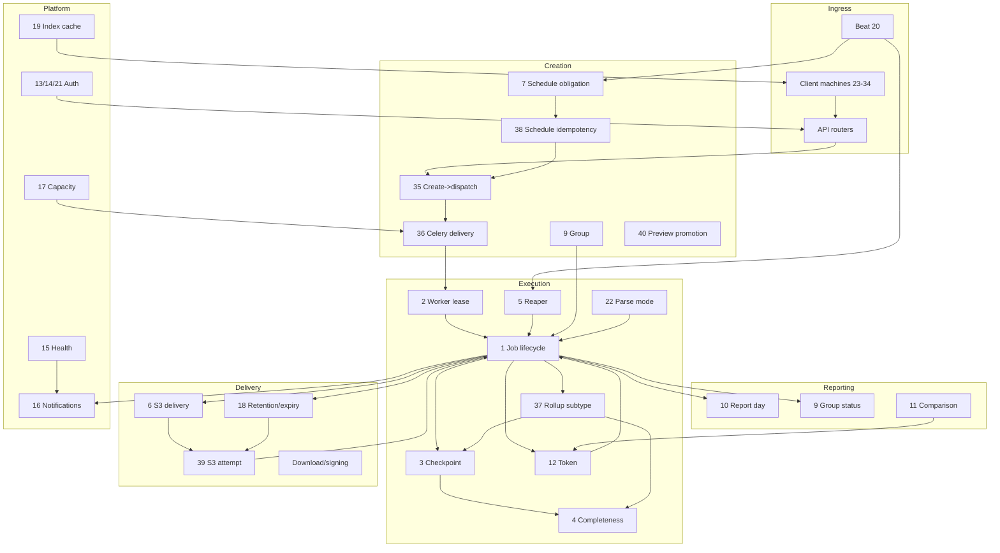

# State Machine Dependencies

Status: architecture map derived from the validated inventory. Not implemented.

This document answers three questions:

1. Which machine owns a transition, and which machines consume it?
2. Which database fields are shared, and therefore which changes have a
   multi-machine blast radius?
3. Where are the cycles and feedback loops that make a local fix insufficient?

Legend: **[V]** verified current behavior, **[R]** recommendation, **[A]**
assumption.

## 1. Dependency overview

The job row is the hub. Almost every business machine either writes it,
derives from it, or observes its events.



## 2. Parent / child registry

A **parent** owns the transition. A **child** consumes the resulting state or
is triggered by it. "Shared fields" are the contract between them.

| # | Machine | Parent(s) | Children / consumers | Shared fields | Trigger direction |
|---|---|---|---|---|---|
| 1 | Job lifecycle | 35 create, 36 Celery, 7 schedule, 9 group, 37 rollup | 2,3,4,5,6,9,10,18,39,40 | `jobs.status`, timestamps, `error_message` | inbound + outbound |
| 2 | Worker lease | 36 Celery, 1 | 3,4,5,37 | `status`, `started_at`, `job_events.ts`, future `owner/lease` | inbound from broker |
| 3 | Checkpoint | 2,1 | 4,37,10 | `checkpoint`, `rows_written`, counters | inbound |
| 4 | Completeness | 3,37 | 9,10,18 | `completion_state`, `gap_*`, `error_message` | outbound |
| 5 | Reaper | 2,20 beat | 1,10,16 | `status`, `job_events.ts` | outbound |
| 6 | S3 delivery | 1 | 18,39,10? | `s3_*` | inbound/outbound |
| 7 | Schedule obligation | 20 beat | 35,38,10 | `enabled`, `last_run_at`, `calendar_day` | outbound |
| 8 | Ownership tags | 1,7,9,37,40 | 10,37,9 | `created_by`, `rollup_of`, `is_preview`, `group_id` | outbound |
| 9 | Group | 1 | 1,10 | `group_id`, `parent_group_id` | both |
| 10 | Report day | 7,8,1,4 | 16 (alerts) | `created_by`, `created_at`, `status`, `rows_written` | read-only |
| 11 | Comparison | 12 token | - | `comparison_runs.*` | independent |
| 12 | Token | credentials | 1,11 | encrypted token columns, expiry | both |
| 13 | Login throttle | 21 auth | - | Redis key | inbound |
| 14 | OAuth | 21 auth | - | signed state, cookie, users | inbound |
| 15 | Health | platform | 16 | Redis latches, app_settings | outbound |
| 16 | Notification | 1,5,6,15 | - | config, no delivery state | inbound |
| 17 | Capacity | admin | 36 Celery | env, live pool | outbound |
| 18 | Retention | 1 | 6,37,download | artifact paths, `finished_at` | outbound |
| 19 | Index cache | index CRUD | 23,30 | Redis key, `index_targets` | outbound |
| 20 | Beat/readiness | platform | 5,7,15,admin | Redis beat key | outbound |
| 21 | Auth session | 13,14 | all API calls | `lv_token` | outbound |
| 22 | Parse mode | 1,7,23 | 3,4 | aggregation booleans | inbound |
| 23 | Wizard | 19,24,25 | 1 | create payload | outbound |
| 24 | Save conflict | 23 | templates | `filter_templates.name` | outbound |
| 25 | Auto-detect | 23 | 22 | regex/format | outbound |
| 26 | Jobs list | 1 | 28 | `status`, selection | read |
| 27 | Live feed | 1 | 28 | `status`, events | read |
| 28 | Job actions | 1 | 26,27 | action endpoints | outbound |
| 29 | Templates | 23,35 | 1 | template fields | outbound |
| 30 | Schedule forms | 7 | 7,37 | schedule fields | outbound |
| 31 | Groups UI | 9 | 1 | group/job fields | read |
| 32 | Reports UI | 10 | - | report fields | read |
| 33 | Palette | - | navigation | none | local |
| 34 | Login form | 13,14,21 | 21 | credentials | outbound |
| 35 | Create->dispatch | API routes | 36,1 | `jobs.status`, broker | outbound |
| 36 | Celery delivery | broker | 2,35 | `redelivered`, task args | both |
| 37 | Rollup subtype | 1,3,4 | 9,10,18 | `rollup_of`, store files, status | inbound/outbound |
| 38 | Schedule idempotency | 7 | 1,10 | `created_by`, `start_epoch` | inbound |
| 39 | S3 attempt | 6 | 6,18 | `s3_*`, future lock | both |
| 40 | Preview promotion | 23,1 | 8,35 | `is_preview`, filter spec | outbound |

## 3. Shared-field blast radius

This is the practical table for change planning. If a change touches a field
in the left column, these machines are affected.

| Field | Writers | Readers / derivations | Change risk |
|---|---|---|---|
| `jobs.status` | API create/cancel/pause/resume, worker, reaper, rollup | every UI page, groups, reports, SSE, reaper, claim | **Critical.** 14+ definitions. |
| `jobs.started_at` | claim, reclaim | reaper fallback, ETA, UI | Medium. Reclaim overwrites it. |
| `jobs.finished_at` | runner, reaper, rollup | retention, reports? (no), downloads, UI | High. Missing on queued-cancel blocks cleanup. |
| `jobs.error_message` | runner, reaper, tasks | UI, reaper message, alerts, completeness today | High. Free-text used as a state. |
| `jobs.checkpoint` | worker | resume, completeness, rollup? | High. Not copied by retry. |
| `jobs.rows_written` | worker | reports, groups, dashboard, progress | Medium. Partial writes on cancel. |
| `jobs.total_chunks` / `completed_chunks` | worker, rollup, migration 0024 | progress bar, UI, report? | Medium. Adaptive sizing. |
| `jobs.created_by` | API, beat, rollup | reports, alerts, BigQuery, rollup source query | **High.** String prefix parsed in 3+ places. |
| `jobs.rollup_of` | rollup create, retry | task dispatch, rollup execution, UI | High. Retry must preserve. |
| `jobs.group_id` | batch/group create, retry? | group status/counts, UI | High. Single retry drops it. |
| `jobs.is_preview` | create, retry, group | list, reports, S3, rollup | Medium. Preview promotion drops siblings. |
| artifact paths | runner, rollup, delete-files, retention | downloads, S3, UI, rollup concat | High. Retention changes availability. |
| `s3_*` | runner, S3 retry | UI badge, alerts, completeness? | Medium. Partial success ambiguous. |
| `schedules.enabled` | toggle/update | beat, reports | Medium. |
| `schedules.last_run_at` | beat only | beat owed windows, schedules UI, report fallback | **High.** Dispatch cursor mistaken for success. |
| `extraction_groups.parent_group_id` | group retry | group detail lineage | Low. DAG, no cycle. |
| `job_events.ts` | worker, API? | reaper, reclaim, SSE | High. Liveness proxy. |
| `last9_credentials.*token*` | token manager, OAuth, test-connection | worker, comparison, credentials UI | High. Rotation race. |
| `app_settings["reports"]` | reports settings | reports page | Low. |
| `app_settings["health_alerts"]` | admin | health monitor | Low. |
| Redis `logvault:beat` | beat | `/health/ops` | Low. |
| Redis `logvault:health:*` | monitor | monitor, admin widget | Low. |
| Redis `login:fail:*` | auth | auth | Low. |

## 4. Event triggers

| Trigger | Source | Machines advanced | Notes |
|---|---|---|---|
| `POST /jobs` | UI/API | 1,8,22,35,36 | commit then publish |
| `POST /jobs/batch` | UI/API | 1,8,9,35 | multi-job + group |
| `POST /groups` | UI/API | 1,8,9,35 | same |
| `POST /jobs/rollup` | schedules UI | 1,8,37,35 | source scan at creation |
| `POST /jobs/{id}/pause` | UI | 1,4 (request) | worker observes |
| `POST /jobs/{id}/resume` | UI | 1,35 | dispatch |
| `POST /jobs/{id}/cancel` | UI | 1 | immediate write |
| `POST /jobs/bulk-cancel` | UI | 1 | per-id loop |
| `POST /groups/{id}/cancel` | UI | 1,9 | per-child loop |
| `POST /groups/{id}/retry` | UI | 1,8,9,35 | new group |
| `POST /jobs/{id}/retry` | UI | 1,8,35 | new job; drops group |
| `POST /jobs/{id}/s3-upload` | UI | 6,39 | no lock |
| `DELETE /jobs/{id}/files` | UI | 18 | nulls paths |
| `POST /schedules` / PATCH / toggle / delete | UI | 7,10 | config |
| Celery `run_job` | broker | 2,36,1,3,4 | redelivery flag |
| Celery `scan_schedules` | beat 60 s | 7,38,1,35 | transaction + dispatch |
| Celery `reap_stale_jobs` | beat 300 s | 5,1,16 | events cutoff |
| Celery `cleanup_exports` | beat 3600 s | 18,6,37 | file deletion |
| Celery `check_system_health` | beat 60 s | 15,16 | Redis latch |
| Celery `upload_job_s3` | broker | 39,6 | retry |
| `GET /jobs/{id}/progress` | EventSource | 27 | signed ticket |
| `GET /jobs/{id}/download` | browser | 18 | signed URL |
| `GET /reports` | UI | 10 | derived |
| `POST /comparisons/{id}/run` | UI | 11,12 | synchronous |
| Login / Google callback | browser | 13,14,21 | Redis + JWT |
| `/ready`, `/health/ops` | probe/UI | 20 | Redis/Postgres |

## 5. Cycles and feedback loops

### 5.1 Schedule -> Job -> Report -> Schedule

The report reads the schedule and its jobs. It does not write the schedule,
so this is a read-only feedback loop, but it creates two sources of truth:

- the scheduler trusts `last_run_at`;
- the report trusts job rows.

They diverge when dispatch fails, when a job is failed/canceled, or when a
backfill is attributed to the creation date. This is a **semantic cycle**, not
a database cycle.

### 5.2 Retention -> Rollup -> Job -> Retention

Retention can delete a source distinct-value store that a later rollup needs.
The rollup then `completed` with skipped sources, and its own artifact becomes
subject to the same retention. This is a real cross-machine cycle:

```
retention deletes store -> rollup skips source -> rollup completes partial
-> rollup artifact later expires -> report/rollup consumer loses input
```

Mitigation: select rollups before retention, extend store retention for
sources referenced by a pending/planned rollup, or record and surface
`completion_state=partial`.

### 5.3 Group -> Job -> Group

Group status is derived from child jobs, and group actions (cancel/retry)
write child jobs. This is a normal parent/child loop. It is safe because the
group row has no status to drift. The only risk is inconsistent derivation
rules between the API, the group detail page, and the jobs list.

### 5.4 Token -> Job -> Token

A running job refreshes a credential token and persists the rotation. A second
job using the same credential may refresh concurrently. This is a shared-state
loop with no lock. The comparison endpoint has a per-request lock; workers do
not **[V]**.

### 5.5 S3 retry -> Job row -> UI -> S3 retry

A failed upload sets `s3_error`; the UI offers retry; the retry clears or
rewrites the fields. Without an attempt lock, two retries can loop. This is a
user-driven feedback loop.

### 5.6 Health -> Notification -> Operator -> Capacity

A health alert may prompt an operator to grow the pool, which changes
throughput and therefore future health samples. This is a human-in-the-loop
cycle, not a code cycle.

### 5.7 Retry lineage

`parent_group_id` always points to an older group, so the lineage is a DAG.
Single-job `retry_of` does not exist today; if added, it must point to an older
job. There is no cycle risk if creation time is monotonic.

## 6. Coupling hotspots

### 6.1 `created_by` string protocol

`created_by` is overloaded:

- `schedule:<id>` for beat jobs;
- `rollup:<id>` for rollups;
- user email for manual jobs;
- user email for group retries (lineage lost).

Readers parse the prefix in:

- `reports.py:309-325` and `397-404`;
- `runner.py:64-89` (scheduled alerts);
- `runner.py:744-769` (BigQuery scheduled load);
- `scheduler.py` (source query);
- `rollup.py:53-73` (source query).

A malformed or newly prefixed value silently drops a job from reports or
alerts. Recommendation: replace the string protocol with explicit columns
(`owner_kind`, `owner_id`) or a shared parser that validates the prefix.

### 6.2 `status` as a proxy for capability

The UI enables pause/resume/cancel based on `status`. The server validates the
same status but with different sets. There is no `can_pause`/`can_resume`
capability in `JobOut`. A stale client can therefore show an action that 409s.
Recommendation: include a `capabilities` object in `JobOut` derived from the
same state helper.

### 6.3 `filter_spec` as the payload

`filter_spec` carries the label, customer, aggregation config, phrases, IDs,
and exclusions. It is read by the worker, the rollup, the report, the
download-naming code, and the preview promotion. A clone that omits a key
changes behavior silently. The preview promotion currently omits
`exclude_phrases` and `exclude_exact_phrases` **[V]**
(`jobs/[id]/page.tsx:93-113`).

### 6.4 `s3_*` as a delivery state

The UI derives a badge from three fields, the retry endpoint checks one, and
the worker writes all of them. There is no single helper. Partial success is
ambiguous.

## 7. Ownership boundaries

| Boundary | Contract | Current state |
|---|---|---|
| API -> broker | publish job id; no idempotency key | **[V]** no outbox |
| Broker -> worker | task name + job id + `redelivered` | **[V]** |
| Worker -> DB | Core SQL; no ORM events | **[V]** `updated_at` not maintained |
| Worker -> filesystem | exclusive writer per job | **[V]** no fence |
| Worker -> S3 | additive upload | **[V]** |
| API -> web | OpenAPI `JobOut` + signed URLs | **[V]** |
| Web -> API | JSON + bearer JWT | **[V]** |
| API -> Redis | cache/throttle/beat/latch | **[V]** fail-open for login |
| API -> Last9 | OAuth refresh + query | **[V]** |
| Worker -> Last9 | independent token manager | **[V]** no cross-worker lock |

## 8. Blast-radius ranking

If a single machine fails, how much of the product is affected?

| Rank | Machine | Why |
|---|---|---|
| 1 | Job lifecycle | Every list, detail, report, group, download, alert. |
| 2 | Worker lease | Duplicate writes corrupt artifacts and counts. |
| 3 | Schedule | Silent missed days; reports look healthy. |
| 4 | Completeness | Decisions made on short data. |
| 5 | Token | Every Last9 read fails; comparisons too. |
| 6 | Retention | Downloads disappear; rollups under-count. |
| 7 | Group derivation | Dashboards disagree with jobs/reports. |
| 8 | S3 delivery | Delivery evidence ambiguous; local copy survives. |
| 9 | Auth | Whole product inaccessible. |
| 10 | Notification | Alerts missed, but data is intact. |

## 9. Dependency rules for implementation

1. **Change the vocabulary once.** A status addition must update the shared
   contract, not 14 files.
2. **Never let the web define lifecycle semantics.** The web mirrors; it does
   not decide.
3. **Keep derived states derived.** Do not add a `group_status` or
   `report_day_status` column to fix a derivation bug; fix the helper.
4. **Persist only what concurrency requires.** Owner/lease, cancel request,
   completeness, and an S3 attempt marker qualify. Display states do not.
5. **Fencing must cover every writer.** A lease that only guards the claim is
   worse than no lease because it implies safety.
6. **Retention is a file lifecycle.** It must not write job status.
7. **Retry is a new row.** Preserve lineage and decide explicitly whether to
   carry the checkpoint.
8. **Schedule dedup belongs in the database.** A check-then-insert cannot be
   made idempotent by comments.

## 10. Summary

The dependency graph is a hub-and-spoke around `jobs`, with three dangerous
cycles:

- retention vs. rollup (data availability);
- token refresh vs. concurrent jobs (shared credential);
- schedule cursor vs. report history (two definitions of "ran").

The rest of the coupling is derived-state coupling: many readers, few writers.
That is good news for the roadmap: a small number of guarded writes and one
shared derivation module remove most of the inconsistency without a large
rewrite.
